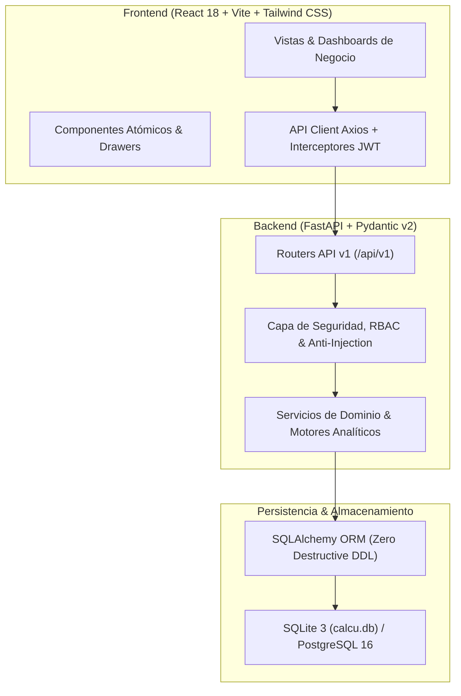

# MANUAL DE ARQUITECTURA TÉCNICA, GOBIERNO DE DATOS Y OPERACIONES
**Sistema Calcu — Plataforma Integral de Supply Chain, Control FP&A y Pricing Inteligente**
*Emitido por el Comité Colegiado: Lead Software Architect & C-Suite Executive Committee*

---

## 1. VISIÓN GENERAL Y ARQUITECTURA DEL SISTEMA

Calcu está estructurado bajo un patrón **Monolito Modular / Clean Architecture**, desacoplando estrictamente el dominio de negocio, los servicios de aplicación, la infraestructura de datos y la interfaz de usuario.



---

## 2. ESTRUCTURA DE DIRECTORIOS Y GOBIERNO DE CÓDIGO

```text
Calcu/
├── app/                           # Monolito modular de backend en FastAPI
│   ├── api/v1/                    # Routers REST agrupados por dominio de negocio
│   │   ├── endpoints.py           # Endpoints centrales, ETL, reportes y métricas
│   │   ├── commercial_routes.py   # CRM, deals, cotizaciones y pipelines B2B
│   │   ├── tenders_routes.py      # Licitaciones estatales y portal de compras
│   │   ├── inventory_routes.py    # Movimientos de stock y reorden
│   │   └── settings.py            # Preferencias de usuario y configuración
│   ├── core/                      # Configuración transversal, seguridad y JWT
│   ├── database/                  # Engine SQLAlchemy, pool de conexiones y migraciones no destructivas
│   ├── domain/                    # Schemas Pydantic v2 defensivos
│   ├── models/                    # Entidades declarativas SQLAlchemy (BCNF / 3NF)
│   └── services/                  # Lógica pura de negocio y motores analíticos
│       ├── etl_service.py         # Motor de ingesta masiva (Excel/CSV) con soporte multimedia
│       ├── ai_advisor_service.py  # Asesor estratégico FP&A con IA local
│       ├── stock_trace_service.py # Trazabilidad por lote y depósito
│       └── ...
├── frontend/                      # Aplicación cliente React + Vite + TypeScript
│   ├── src/
│   │   ├── components/            # Componentes reutilizables, modales y tablas interactivas
│   │   │   ├── common/            # DataTable, MetricCard, ProductThumbnail, ErrorBoundary
│   │   │   ├── layout/            # Sidebar de 4 dominios semánticos, Header y Cockpit
│   │   │   └── ...
│   │   ├── views/                 # Vistas principales organizadas por rol operativo
│   │   │   ├── ControlRoomView.tsx          # Torre de control SKU con Drawer lateral
│   │   │   ├── MultiLocationStockView.tsx   # Matriz logística de 5 depósitos y tránsitos
│   │   │   ├── SupplyKanbanView.tsx         # Pipeline de compras y capital inmovilizado
│   │   │   ├── VarianceScenariosView.tsx    # Presupuestos, variaciones y centros de costo
│   │   │   ├── PricingAnalyticsView.tsx     # Simulador de márgenes y packs IA
│   │   │   ├── CommercialKanbanView.tsx     # Embudo de ventas B2B y despacho
│   │   │   ├── TendersView.tsx              # Monitor de licitaciones estatales
│   │   │   ├── EtlIngestView.tsx            # Carga de archivos y descarga de 5 plantillas
│   │   │   └── directory/                   # Directorio de clientes y proveedores
│   │   ├── services/              # Cliente HTTP y llamadas tipadas a la API
│   │   └── types/                 # Contratos TypeScript sincronizados con Pydantic v2
├── tests/                         # Suite automatizada de pruebas unitarias e integración (Pytest)
├── pytest.ini                     # Delimitación estricta del entorno de pruebas
└── calcu.db                       # Base de datos relacional (producción local)
```

---

## 3. POLÍTICA ESTRICTA DE BASE DE DATOS Y SEGURIDAD

### 3.1. Regla Mandatoria de Cero DDL Destructivo
- **Prohibición de `DROP TABLE` y `TRUNCATE`:** Ningún script de inicio ni migración debe eliminar o recrear tablas que contengan datos operativos o históricos.
- **Evolución Aditiva:** Las actualizaciones de esquema deben ejecutarse de manera idempotente mediante sentencias `ALTER TABLE ... ADD COLUMN` condicionales (o mediante scripts de migración gestionados).
- **Consultas 100% Parametrizadas:** Toda consulta se gestiona a través del ORM de SQLAlchemy (`Session.query(...)` o `select(...)`), prohibiéndose terminantemente concatenaciones directas de cadenas en sentencias SQL.

### 3.2. Segregación de Funciones (RBAC)
El sistema valida roles operativos en los encabezados HTTP y tokens JWT:
1. **Controller / Admin (`controller_admin`):** Acceso total a aprobación de presupuestos, cierre de períodos y configuración.
2. **Supply Chain Manager (`supply_chain`):** Autorización de órdenes de compra, cambio de etapas Kanban (fabricación/tránsito) y transferencias entre depósitos.
3. **Comercial / Vendedor (`sales_rep`):** Creación de tratos CRM, cotizaciones y compromisos de stock para clientes.
4. **Viewer / Auditor (`viewer`):** Acceso de solo lectura a tableros ejecutivos y estados contables.

---

## 4. MOTOR ETL DE INGESTA Y PROTOCOLO MULTIMEDIA

El motor ETL ([`app/services/etl_service.py`](file:///c:/Users/sebar/OneDrive/Desktop/Calcu/app/services/etl_service.py)) procesa archivos `.xlsx` y `.csv` de hasta 10 MB con sanitización preventiva contra inyección de fórmulas CSV.

### 4.1. Catálogos y Especificación de Imágenes
Las plantillas aceptan columnas normalizadas para imágenes de producto:
- **Cabeceras Aceptadas:** `imagen`, `foto`, `thumbnail`, `image_url`, `url_foto`.
- **Formato Válido:** URLs directas HTTPS (CDN, Google Drive público, Dropbox directo, S3 o servidores de proveedores) o rutas locales relativas.
- **Renderizado Frontend:** El componente `ProductThumbnail` implementa fallback automático y visor ampliado con zoom en popover/drawer.

### 4.2. Plantillas Oficiales Descargables
A través de `/api/v1/etl/template?tipo_archivo={tipo}`:
1. `inventario`: SKU, Nombre, Categoría, Precio Venta USD, Costo USD, Stock Actual, ROP, Lead Time, URL Imagen.
2. `ordenes_compra`: Número PO, Proveedor, SKU, Cantidad, Costo Unitario USD, Incoterm (FOB/CIF), Depósito Destino, URL Catálogo.
3. `ordenes_venta`: Número OV, Cliente, RUT, SKU, Cantidad, Precio Unitario USD, Canal, Depósito Despacho, URL Comprobante.
4. `opex`: Código Centro Costo, Nombre Centro, Período, Monto Presupuestado USD, Monto Real USD.
5. `crm`: Código Trato, Cliente, Vendedor, Etapa, Monto Total USD, Probabilidad (%), Fecha Cierre.

---

## 5. ERGONOMÍA VISUAL Y NORMAS DE EXPERIENCIA DE USUARIO

1. **Progressive Disclosure:** 
   - Las tablas principales muestran exclusivamente métricas sintéticas críticas (SKU, Nombre, Stock, ROP, Estado).
   - Los datos multidimensionales (desglose por depósito, parámetros de seguridad, histórico de compras, imágenes HD) se despliegan en **Drawers laterales (Slide-Over)** accionables al hacer clic en la fila o en el botón de detalle.
2. **Dark Mode Riguroso:**
   - Paleta institucional basada en `slate-900` para fondos de tarjetas y `slate-950` para el fondo maestro de la aplicación.
   - Textos de alto contraste `slate-100` / `slate-200` y etiquetas secundarias en `slate-400`.
   - Acentos funcionales: Esmeralda (`emerald-500` / `emerald-400`) para márgenes saludables y aprobaciones; Ámbar (`amber-500`) para alertas de reposición; Azul (`sky-500` / `blue-500`) para tránsitos y logística.
3. **Prevención de Layout Shift:**
   - Bloques analíticos extensos (como los diagnósticos del Asesor IA) utilizan contenedores colapsables con contadores de sugerencias, preservando la estabilidad visual de las tablas de datos.

---

## 6. PROTOCOLO DE AUDITORÍA Y CALIDAD DE SOFTWARE

Para asegurar la estabilidad permanente del sistema, se deben cumplir los siguientes comandos de verificación previo a cualquier despliegue:

```bash
# 1. Verificación de la suite de pruebas unitarias e integración (Backend)
python -m pytest tests -q

# 2. Verificación estricta de tipos y empaquetado de producción (Frontend)
cd frontend
npm run build
```

Ambos procesos deben reportar **0 errores** de ejecución.
