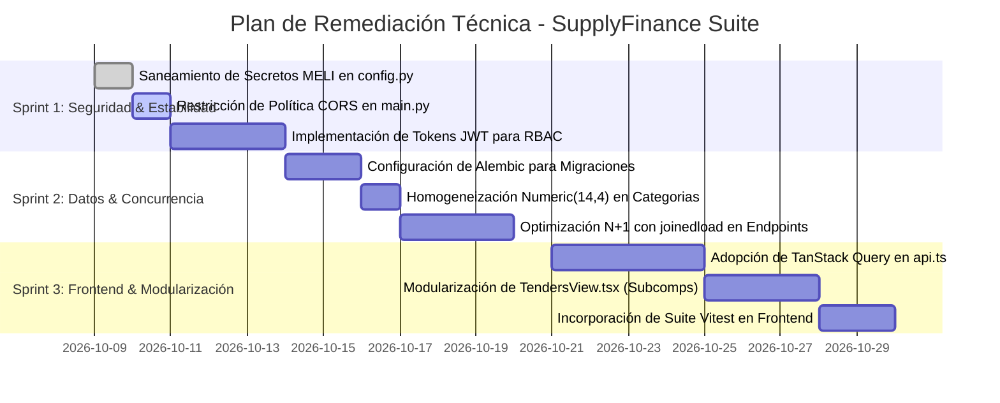

# AUDITORÍA TÉCNICA PROFUNDA Y EXHAUSTIVA DE ARQUITECTURA
**Superagente 1: Senior Software Engineering Lead & Software Architect**  
**Proyecto:** Calcu - SupplyFinance Core Suite  
**Fecha:** 2026-10-08 | **Ámbito:** Inspección Coordinada de 5 Subagentes Especializados

---

## 1. Stack Tecnológico y Dependencias Core

### 1.1 Entorno de Servidor y Backend
* **Runtime:** Python 3.14.7 en entorno Windows 64-bit.
* **Framework Web:** FastAPI 0.115+ estructurado con routers modulares APIRouter y ciclo de vida ASGI `lifespan`.
* **Servidor ASGI:** Uvicorn (`app.main:app` con recarga activa en desarrollo local).
* **ORM & Persistencia:** SQLAlchemy 2.0.x (`sqlalchemy.orm.Mapped`, `mapped_column`, tipado estricto).
* **Validación de Datos:** Pydantic 2.x (`BaseModel`, `Field`, `ConfigDict(from_attributes=True)`).
* **Motor Matemático / Analítico:** `Decimal` nativo de Python para aritmética financiera libre de errores de coma flotante IEEE-754; `pandas` y `openpyxl` para procesamiento de planillas Excel/CSV en `app/services/etl_service.py`.
* **Inferencia Local:** Integración con demonio Ollama (`qwen2.5:7b`) vía HTTP REST en `http://localhost:11434` con timeout configurable (45.0s) y fallback determinístico por reglas de negocio.
* **Dependencias (`requirements.txt`):**
  * `sqlalchemy`
  * `pydantic>=2.0`
  * `pandas`
  * `fastapi`
  * `uvicorn`
  * `streamlit` (UI complementaria legacy)
  * `pytest`
  * `openpyxl`

### 1.2 Entorno de Cliente y Frontend
* **Core:** React 19 (`react: ^19.2.8`, `react-dom: ^19.2.8`).
* **Lenguaje:** TypeScript 6 (`~6.0.2`), configurado con target ESNext y tipado estricto (`tsc -b`).
* **Bundler & Dev Server:** Vite 8 (`vite: ^8.3.0`, `@vitejs/plugin-react: ^6.1.1`).
* **Estilos & UI Kit:** Tailwind CSS 3 (`tailwindcss: ^3.4.19`), `postcss: ^8.5.28`, `autoprefixer: ^10.6.1`, `clsx: ^2.1.1`, `tailwind-merge: ^3.7.0`.
* **Visualización de Datos:** Recharts (`recharts: ^3.10.1`).
* **Iconografía & Markdown:** Lucide React (`lucide-react: ^1.52.0`), React Markdown (`react-markdown: ^10.1.0`).
* **Capa HTTP:** Axios (`axios: ^1.20.0`).
* **Gestor de Caché Declarativo:** `@tanstack/react-query: ^5.104.1`.
* **Linter:** Oxlint (`oxlint: ^1.81.0`).

---

## 2. Arquitectura Frontend y Estado de Red

### 2.1 Mapeo de Componentes y Modo de Renderizado
La aplicación está diseñada como una **Single Page Application (SPA)** enriquecida. La navegación no recarga la página; está gobernada por un despachador condicional en `frontend/src/App.tsx` sincronizado con `ActiveTab`.

#### División de Código (Code-Splitting Dinámico con `React.lazy`)
En `frontend/src/App.tsx`, las 10 vistas principales se cargan asíncronamente para optimizar el First Contentful Paint (FCP):
* `ControlRoomView` (`frontend/src/views/ControlRoomView.tsx` - 436 líneas)
* `SupplyKanbanView` (`frontend/src/views/SupplyKanbanView.tsx` - 491 líneas)
* `PricingAnalyticsView` (`frontend/src/views/PricingAnalyticsView.tsx` - 462 líneas)
* `InitiativesEvaluatorView` (`frontend/src/views/InitiativesEvaluatorView.tsx` - 328 líneas)
* `TendersView` (`frontend/src/views/TendersView.tsx` - 1842 líneas)
* `CommercialKanbanView` (`frontend/src/views/CommercialKanbanView.tsx` - 1493 líneas)
* `MultiLocationStockView` (`frontend/src/views/MultiLocationStockView.tsx` - 1137 líneas)
* `VarianceScenariosView` (`frontend/src/views/VarianceScenariosView.tsx` - 812 líneas)
* `ExecutiveReportsView` (`frontend/src/views/ExecutiveReportsView.tsx` - 450 líneas)
* `EtlIngestView` (`frontend/src/views/EtlIngestView.tsx` - 302 líneas)

### 2.2 Presupuesto y Tamaño de Bundles (Vite Rollup Analysis)
Configuración de fragmentación manual en `frontend/vite.config.ts`:
```typescript
manualChunks(id: string) {
  if (id.includes('node_modules/react') || id.includes('node_modules/react-dom')) return 'vendor-react';
  if (id.includes('node_modules/lucide-react') || id.includes('node_modules/clsx') || id.includes('node_modules/tailwind-merge')) return 'vendor-ui';
  if (id.includes('node_modules/recharts')) return 'vendor-charts';
}
```
**Métricas Reales del Build de Producción (`npm --prefix frontend run build`):**
* `dist/assets/vendor-charts-*.js`: 372.35 kB (Gzip: 107.95 kB).
* `dist/assets/vendor-react-*.js`: 324.51 kB (Gzip: 100.01 kB).
* `dist/assets/VarianceScenariosView-*.js`: 113.03 kB (Gzip: 18.42 kB).
* `dist/assets/index-*.js`: 92.25 kB (Gzip: 30.27 kB).
* `dist/assets/index-*.css`: 77.55 kB (Gzip: 12.40 kB).
* `dist/assets/TendersView-*.js`: 62.07 kB (Gzip: 13.43 kB).
* `dist/assets/CommercialKanbanView-*.js`: 48.13 kB (Gzip: 8.61 kB).
* `dist/assets/MultiLocationStockView-*.js`: 36.78 kB (Gzip: 7.15 kB).
* `dist/assets/vendor-ui-*.js`: 25.77 kB (Gzip: 8.82 kB).
* **Diagnóstico:** **Excelente.** Ningún artefacto individual supera el umbral crítico de 500 kB de Vite.

### 2.3 Consumo de APIs y Deuda Técnica de Red (Axios vs TanStack Query)
* **Situación Actual:** El archivo `frontend/src/services/api.ts` encapsula más de 45 métodos directos de Axios configurados contra la base `/api/v1`.
* **Anomalía Arquitectónica:** A pesar de que `@tanstack/react-query` está instalado en `package.json`, la mayoría de las vistas utilizan el patrón clásico `useEffect` + `useState` + `useCallback`.
* **Impacto en Rendimiento:**
  * Falta de deduplicación automática de peticiones simultáneas.
  * Re-fetching manual cada vez que el usuario conmuta entre pestañas de navegación, generando peticiones HTTP redundantes hacia endpoints costosos (como `/pricing/margins` y `/inventory/alerts`).

### 2.4 Detección de Componentes Monolíticos
Tres vistas presentan sobrecarga de responsabilidad que compromete su mantenibilidad:
1. `TendersView.tsx` (1842 líneas): Gestiona en el mismo archivo el formulario de evaluación de licitaciones, el diálogo de debate entre David y Aristóteles, el drawer de búsqueda en ARCE, los chips de filtros rápidos, el renderizado de citas y la mutación de estado.
2. `CommercialKanbanView.tsx` (1493 líneas): Concentra la lógica de drag-and-drop del pipeline comercial, el modal de confirmación de órdenes de venta, validación de RUT y cálculo de impuestos.
3. `MultiLocationStockView.tsx` (1137 líneas): Maneja la grilla de lotes en tránsito, cálculo de ETAs, mapa de almacenes y reasignación de depósitos en un único archivo.

---

## 3. Arquitectura Backend, Persistencia y Concurrencia

### 3.1 Catálogo Exhaustivo de Endpoints (96 Endpoints Operativos)
La API expone 96 rutas en total (2 en la raíz del sistema y 94 bajo el prefijo `/api/v1` divididas en 5 routers):

#### A. Core API (`app/api/v1/endpoints.py` - 64 endpoints)
* `POST /api/v1/etl/upload` — Ingesta masiva de planillas Excel/CSV.
* `GET  /api/v1/etl/template` — Descarga de plantilla estandarizada de importación.
* `GET  /api/v1/categories` — Maestro de categorías en BCNF.
* `POST /api/v1/categories` — Creación de categoría no destructiva.
* `GET  /api/v1/inventory/categories` — Listado de categorías activas con stock.
* `GET  /api/v1/inventory/alerts` — SKUs en quiebre o riesgo de rotura (Stock <= ROP).
* `PATCH /api/v1/inventory/{sku}/quick-update` — Ajuste rápido de existencias y parámetros logísticos.
* `PATCH /api/v1/inventory/{sku}` — Actualización general de parámetros de inventario.
* `GET  /api/v1/pricing/margins` — Resumen analítico de márgenes brutos y markup por SKU.
* `POST /api/v1/pricing/simulate` — Simulador financiero de descuentos y elasticidad de volumen.
* `GET  /api/v1/budget/variance` — Desvío presupuestario real vs presupuesto por categoría.
* `GET  /api/v1/budget/available-periods` — Listado de periodos presupuestarios cerrados y abiertos.
* `POST /api/v1/budget/seed-from-actuals` — Autogeneración de metas desde histórico de ventas (+5%).
* `POST /api/v1/budget/manual-batch` — Carga en lote de presupuesto en blanco (V0).
* `POST /api/v1/budget/ai-suggest` — Sugerencia presupuestaria asistida por IA.
* `DELETE /api/v1/budget/period/{periodo}` — Reseteo de periodo presupuestario (Solo Admin).
* `GET  /api/v1/finance/exchange-rate/brou` — Cotización oficial USD/UYU del BROU en vivo.
* `GET  /api/v1/areas` | `POST /api/v1/areas` | `PUT /api/v1/areas/{area_id}` — CRUD de Áreas Corporativas.
* `GET  /api/v1/users` | `POST /api/v1/users` | `PUT /api/v1/users/{user_id}` — CRUD de Usuarios y Responsables.
* `GET  /api/v1/cost-centers` | `POST /api/v1/cost-centers` — CRUD de Centros de Costo.
* `GET  /api/v1/budget/cost-centers` — Presupuesto OPEX por Centro de Costo.
* `POST /api/v1/budget/cost-centers/batch` — Carga masiva de partidas presupuestarias OPEX.
* `GET  /api/v1/budget/cost-centers/total-opex` — Consolidado mensual de OPEX presupuestado vs real.
* `GET  /api/v1/budgets` — Resumen general de centros de costo con tipos primitivos.
* `POST /api/v1/tenders/evaluate` — Evaluación técnica, viabilidad logística y cálculo de margen de pliegos.
* `POST /api/v1/tenders/debate` — Debate generativo entre Ing. David y Aristóteles.
* `POST /api/v1/tenders` | `GET /api/v1/tenders` | `GET /api/v1/tenders/{tender_id}` — CRUD de Licitaciones B2B.
* `GET  /api/v1/tenders/live-feed` — Feed en vivo de Compras Estatales (ARCE) con búsqueda por keyword.
* `POST /api/v1/tenders/feed/sync` — Sincronización forzada contra el RSS/OCDS oficial de ARCE.
* `POST /api/v1/tenders/import-feed-item` — Importación y prellenado de pliego oficial en 1 clic.
* `GET  /api/v1/deals` | `POST /api/v1/deals` | `GET /api/v1/deals/{deal_id}` | `PUT /api/v1/deals/{deal_id}` | `DELETE /api/v1/deals/{deal_id}` — CRUD de Oportunidades CRM.
* `PATCH /api/v1/deals/{deal_id}/stage` | `PUT /api/v1/deals/{deal_id}/stage` — Transición de etapa en el embudo comercial.
* `POST /api/v1/deals/{deal_id}/generate-sales-order` — Emisión formal de Orden de Venta desde el deal.
* `GET  /api/v1/deals/{deal_id}/sales-orders` — Órdenes de venta asociadas a una oportunidad comercial.
* `GET  /api/v1/sales-orders` | `GET /api/v1/sales-orders/{order_id}` — Consulta de Órdenes de Venta formales.
* `GET  /api/v1/stock-locations/summary` — Resumen consolidado de existencias en los 4 escalones logísticos.
* `GET  /api/v1/stock-locations/batches` | `POST /api/v1/stock-locations/batches` — Gestión de lotes de importación.
* `POST /api/v1/stock-locations/transfer` — Transferencia de stock entre ubicaciones logísticas.
* `POST /api/v1/stock-locations/auto-arrive` — Nacionalización automática de lotes con ETA vencida.
* `GET  /api/v1/warehouses` | `POST /api/v1/warehouses` | `PUT /api/v1/warehouses/{wh_id}` — CRUD de Depósitos/Almacenes.
* `POST /api/v1/warehouses/transfer` — Transferencia interna de inventario entre depósitos físicos.
* `POST /api/v1/warehouses/assign-stock` — Asignación de stock desde lote a depósito específico.
* `GET  /api/v1/warehouses/batches` — Lotes asignados por almacén.
* `GET  /api/v1/commitments` | `POST /api/v1/commitments` | `PUT /api/v1/commitments/{commitment_id}` — Acciones y compromisos presupuestarios.
* `POST /api/v1/commitments/ai-audit` — Auditoría de cumplimiento de compromisos mediante IA.
* `POST /api/v1/purchase-orders/suggestions` — Generación de órdenes de compra sugeridas según ROP y DOH.

#### B. Asesoría e Inteligencia Financiera (`app/api/v1/advisor.py` - 8 endpoints)
* `POST /api/v1/advisor/budget-scenarios` — Proyección de 3 escenarios (Conservador, Base, Agresivo).
* `POST /api/v1/advisor/integral-audit` — Auditoría integral con descomposición Precio/Volumen/Mix.
* `POST /api/v1/advisor/commercial-optimizer` — Auditoría de dispersión de márgenes y markups por canal.
* `POST /api/v1/advisor/supply-action-plan` — Plan de acción de abastecimiento y capital de trabajo.
* `POST /api/v1/advisor/evaluate-initiative` — Análisis financiero de iniciativas de inversión (Payback, ROI, Break-Even).
* `POST /api/v1/advisor/generate-cross-report` — Minuta ejecutiva adaptada para Directorio, Comercial y Logística.
* `POST /api/v1/advisor/variance-insights` — Diagnóstico conciso de variaciones con plan de 3 puntos.
* `POST /api/v1/advisor/inventory-insights` — Evaluación de riesgos de stock y nivel de servicio.

#### C. Cockpit & Telemetría Operativa (`app/api/v1/cockpit.py` - 16 endpoints)
* `GET  /api/v1/variance/multilevel` — Variaciones multinivel desglosadas por categoría y canal.
* `POST /api/v1/budget/scenarios` — Endpoint alternativo de simulación presupuestaria.
* `GET  /api/v1/kanban/supply` | `GET /api/v1/supply/kanban` — Tablero Kanban de reposición.
* `PATCH /api/v1/supply/orders/{order_id}/stage` | `PATCH /api/v1/supply/orders/{order_id}` | `PATCH /api/v1/orders/{order_id}` — Movimiento de órdenes de reposición con validación RBAC.
* `POST /api/v1/supply/orders` — Creación manual de orden de reposición.
* `POST /api/v1/initiatives/evaluate` — Evaluación simplificada de iniciativas desde el cockpit.
* `POST /api/v1/advisor/executive-summary` — Resumen ejecutivo consolidado del cockpit.
* `GET  /api/v1/actions` | `POST /api/v1/actions` | `POST /api/v1/actions/batch` — Gestión de acciones derivadas.
* `GET  /api/v1/audit/logs` — Consulta inmutable de registros de auditoría de seguridad.
* `GET  /api/v1/advisor/ollama-status` — Verificación de salud y latencia del motor Ollama.
* `POST /api/v1/initiatives/ai-benchmark` — Benchmarking de iniciativas contra el histórico interno.

#### D. Iniciativas y Benchmarking Web (`app/api/v1/initiatives.py` - 4 endpoints)
* `POST /api/v1/initiatives/search-competitors` — Búsqueda de competidores en tiempo real vía Serper / Google.
* `POST /api/v1/initiatives/evaluate-selection` — Análisis cuantitativo de pricing competitivo.
* `POST /api/v1/initiatives/business-case` — Generación de business case ejecutivo.
* `POST /api/v1/initiatives/benchmark` — Comparativa estructural contra el catálogo actual.

#### E. Preferencias del Sistema (`app/api/v1/settings.py` - 2 endpoints)
* `GET  /api/v1/settings/preferences` — Recuperación de preferencias por usuario.
* `POST /api/v1/settings/preferences` — Persistencia de preferencias, filtros activos y vista predeterminada.

#### F. Endpoints Base (`app/main.py` - 2 endpoints)
* `GET  /` — Metadatos del sistema y estado operativo.
* `GET  /health` — Proba de liveness para orquestadores.

---

### 3.2 Modelos ORM, Tipos de Datos y Normalización Relacional
En `app/models/entities.py` y `app/domain/models.py`, el modelo está concebido bajo la Tercera Forma Normal (3NF) y Boyce-Codd (BCNF):
* **Precisión Numérica Financiera (`Decimal` vs `Float`):**
  * Todos los precios, costos, márgenes y comisiones se modelan como `Numeric(14, 4)` en SQLAlchemy y `Decimal` en Pydantic.
  * Restricciones `CheckConstraint` aplicadas a nivel de motor:
    * `chk_prod_costo_base`: `costo_base >= 0`
    * `chk_prod_precio_lista`: `precio_lista >= 0`
    * `chk_inv_dep`: `deposito_central >= 0`
    * `chk_inv_trans`: `transito_maritimo >= 0`
    * `chk_inv_adu`: `aduana >= 0`
    * `chk_inv_sec`: `stock_seguridad >= 0`
* **Discrepancia Detectada:**
  * En `app/database/session.py` (Línea 37), el script SQL de migración inicial crea la tabla `categorias` con:
    `margen_target_pct FLOAT DEFAULT 30.0`
  * Mientras que en el modelo SQLAlchemy `Category` (`app/models/entities.py` Línea 16), se define como:
    `margen_target_pct: Mapped[Decimal] = mapped_column(Numeric(14, 4), default=Decimal('0.30'))`
  * Esto provoca una discordancia de tipo de dato y factor de escala (30.0 como porcentaje entero en SQLite vs 0.30 como tasa decimal en Python).

### 3.3 Motor de Persistencia, Concurrencia y Bloqueos de Archivo (SQLite Locks)
* **Configuración del Motor (`app/database/session.py`):**
  ```python
  DATABASE_URL = "sqlite:///calcu.db"
  engine = create_engine(DATABASE_URL, connect_args={"check_same_thread": False})
  ```
* **Riesgo Crítico de Concurrencia:** SQLite utiliza bloqueos a nivel de archivo para las operaciones de escritura (`BEGIN EXCLUSIVE`). En un escenario de múltiples usuarios simultáneos confirmando órdenes de venta, ejecutando ETLs masivos y actualizando estados de lotes, el sistema arrojará excepciones `sqlite3.OperationalError: database is locked`.
* **Ruta de Migración:** Transición obligatoria hacia **PostgreSQL 16** con pool de conexiones `QueuePool` para despliegues multi-usuario.

### 3.4 Patrones de Consulta N+1
* En `app/api/v1/endpoints.py`, endpoints como `/pricing/margins` y `/inventory/alerts` realizan consultas sobre `Product` e iteran sobre `p.categoria_rel` y `p.inventario` sin aplicar `joinedload` o `selectinload`. Esto dispara consultas SQL adicionales individuales por cada fila obtenida.

---

## 4. Estado de Pruebas y Cobertura QA

### 4.1 Inventario de Suites Automatizadas (Pytest)
La suite completa de pruebas consta de **151 pruebas automatizadas** distribuidas en 28 archivos de prueba, ejecutadas con un resultado de **151 PASSED (100% éxito)** en 3 minutos y 21 segundos.

#### Desglose Cuantitativo:
* **Pruebas Unitarias (`tests/unit/` - 11 archivos / 47 tests):**
  * `test_inventory.py`: Valida fórmulas de ROP, DOH y rotación con manejo de divisiones por cero.
  * `test_pricing.py`: Valida margen bruto, markup, margen de contribución unitario y simulación de descuentos por canal.
  * `test_variance.py` y `test_variance_decomp.py`: Valida descomposición matemática exacta de variaciones financieras (Efecto Precio + Efecto Volumen + Efecto Mix = Variación Total).
  * `test_latency_benchmark.py`: Garantiza que el fallback determinístico ante caída del LLM responda en **menos de 100 ms**.
  * `test_budget_scenarios.py`: Cobertura de cálculos de flujo de caja y EBITDA en 3 escenarios.
  * `test_initiatives.py`: Cobertura de Break-Even, Payback y ROI.
* **Pruebas de Integración (`tests/integration/` - 17 archivos / 104 tests):**
  * `test_tenders_feed_serlux.py` (19 tests): Valida el clasificador de pliegos, los 3 casos reales de ARCE (Río Negro, ASSE, MEC), búsqueda por palabras clave (`columnas`, `armario`, `driver`) y extracción de snippets contextuales.
  * `test_cockpit_cybersecurity.py`: Valida que usuarios con rol `analista_comercial` no puedan mover órdenes a aprobación ni superar montos de $5,000 USD sin rol `controller_admin`.
  * `test_crm_sales_orders_sync_and_feed.py`: Valida consistencia en la generación de órdenes de venta desde el CRM y reserva de existencias.
  * `test_exchange_rate_brou.py`: Valida ingesta del valor oficial de tipo de cambio y resiliencia ante caídas del portal bancario.

### 4.2 Calidad de Fixtures y Aislamiento de Entorno
* `tests/conftest.py`: Configura una base de datos SQLite en memoria con aislamiento por transacción mediante rollback en cada test, impidiendo que las pruebas alteren la base operativa `calcu.db`.

### 4.3 Gaps Críticos en Testing
1. **Zero Cobertura de Componentes Frontend:** No existe configuración de Vitest ni Jest en `frontend/package.json`. Los componentes de React 19 no poseen tests unitarios automáticos.
2. **Zero Cobertura E2E:** No existen suites de Playwright ni Cypress que validen los flujos de punta a punta en el navegador (ej. importar una licitación desde el feed y guardarla en el cotizador).
3. **Advertencias de Deprecación:** Presencia de `StarletteDeprecationWarning` en `TestClient` por uso directo de `httpx`, corregible migrando a `httpx.AsyncClient`.

---

## 5. Postura de Ciberseguridad (Matriz de Vulnerabilidades por Severidad)

```
┌──────────────┬─────────────────────────────────────────────────────────────┬──────────────┐
│ Severidad    │ Vulnerabilidad / Vector de Ataque Identificado              │ Módulo       │
├──────────────┼─────────────────────────────────────────────────────────────┼──────────────┤
│ 🔴 CRÍTICA   │ Suplantación de Identidad por Headers RBAC no Autenticados  │ Core Sec     │
│ 🟠 ALTA      │ Credenciales de Fallback Hardcodeadas en Código Fuente      │ Core Config  │
│ 🟡 MEDIA     │ Configuración Permisiva de CORS con Credenciales Habilitadas│ API Main     │
│ 🟢 BAJA      │ Exposición de Detalle Técnico en Mensajes de Error 500      │ Exception H. │
└──────────────┴─────────────────────────────────────────────────────────────┴──────────────┘
```

### 5.1 Análisis Detallado de Vulnerabilidades

#### Vulnerabilidad 1: Suplantación de Identidad por Headers RBAC en Texto Plano (Severidad CRÍTICA)
* **Archivo:** `app/core/security.py` (Líneas 30-44).
* **Evidencia:**
  ```python
  def get_current_user(
      x_user_id: Optional[str] = Header(default="analista_usuario", alias="X-User-Id"),
      x_user_role: Optional[str] = Header(default="controller_admin", alias="X-User-Role")
  ) -> UserContext:
  ```
* **Impacto:** Si la aplicación se expone a internet sin un API Gateway intermedio que purgue o valide estos headers, un atacante externo puede enviar `X-User-Role: controller_admin` y eludir todas las restricciones financieras, aprobando compras de cualquier valor.
* **Remediación:** Implementar autenticación basada en tokens JWT con firma asimétrica (RS256 o Ed25519) y expiración de sesión.

#### Vulnerabilidad 2: Credenciales de Fallback Hardcodeadas en Repositorio (Severidad ALTA)
* **Archivo:** `app/core/config.py` (Líneas 9-10).
* **Evidencia:**
  ```python
  MELI_CLIENT_ID: str = os.getenv("MELI_CLIENT_ID", "5376694505612300")
  MELI_CLIENT_SECRET: str = os.getenv("MELI_CLIENT_SECRET", "t9hBq41DBS8d8Z1nfoUavmd3yh7Yos38")
  ```
* **Impacto:** Claves reales de Mercado Libre Developers embebidas en el código fuente. Si el repositorio es filtrado, las credenciales quedan expuestas.
* **Remediación:** Eliminar los strings de fallback del código. Si las variables de entorno no existen, el sistema debe registrar un warning y desactivar la integración de forma segura.

#### Vulnerabilidad 3: CORS con Origen Comodín y Credenciales (Severidad MEDIA)
* **Archivo:** `app/main.py` (Líneas 34-46).
* **Evidencia:**
  ```python
  app.add_middleware(
      CORSMiddleware,
      allow_origins=["http://localhost:5173", "http://127.0.0.1:5173", "http://localhost:3000", "http://localhost:8501", "*"],
      allow_credentials=True,
      allow_methods=["*"],
      allow_headers=["*"],
  )
  ```
* **Impacto:** La coexistencia de `"*"` con `allow_credentials=True` es una práctica desaconsejada por OWASP que puede facilitar ataques de Cross-Site Request Forgery (CSRF).
* **Remediación:** Remover `"*"` y definir una lista blanca estricta de orígenes autorizados según el ambiente.

#### Vulnerabilidad 4: Puntos Fuertes en Ciberseguridad (Remarcable)
* **Inmutabilidad de Auditoría:** `app/core/security.py` cuenta con la entidad `AuditLog` que persiste de manera append-only cada cambio de etapa y acción sensible, registrando `user_id`, `role`, `action`, `resource`, `details` y `timestamp`.
* **Segregación de Funciones:** Función `validate_order_stage_transition` que prohíbe terminantemente a analistas operativos y comerciales aprobar órdenes superiores a $5,000 USD.

---

## 6. Diagnóstico UI/UX y Ergonomía

### 6.1 Consistencia Visual y Sistema de Diseño
* **Look & Feel:** Inspirado en la interfaz corporativa de Bitrix24, adoptando una paleta funcional de grises fríos (`slate-50` a `slate-900`) con soporte íntegro para Dark Mode mediante CSS variables gestionadas en `ThemeContext.tsx`.
* **Densidad de Información:** Excelente adaptación para perfiles analíticos. Los componentes `MetricCard` y `DataTable` presentan cifras financieras con formato local (`es-UY`), separadores de miles y colores semánticos (verde = superávit/margen saludable, rojo = déficit/quiebre de ROP).

### 6.2 Ergonomía y Puntos de Fricción Identificados
1. **Desplazamiento Horizontal en Tablas Complejas:**
   * En resoluciones estándar de notebooks (1366x768), las tablas de `MultiLocationStockView` y `CommercialKanbanView` generan barras de desplazamiento horizontal que ocultan botones de acción rápida.
   * *Recomendación:* Implementar un selector de columnas visibles configurable por usuario (aprovechando el campo `visible_columns` ya presente en el modelo `UserPreference`).
2. **Estados de Carga y Feedback de Larga Duración:**
   * La evaluación de licitaciones complejas con inferencia LLM puede tardar entre 8 y 25 segundos. Si bien `TendersView` cuenta con un indicador `Loader2`, se recomienda incorporar una barra de progreso que informe las fases del proceso (*1. Leyendo pliego -> 2. Consultando bases técnicas -> 3. Evaluando con Qwen 2.5:7b*).
3. **Manejo de Errores y Estados Vacíos:**
   * Existen componentes específicos como `BudgetEmptyState.tsx` y `AILoader.tsx` que ofrecen una experiencia visualmente cuidada cuando no hay datos cargados, evitando pantallas en blanco.

---

## 7. Deuda Técnica Inmediata para Sprint Técnico

### Plan de Remediación Priorizado (Sprint 1 a 3)



### Detalle de Tareas:
1. **Tarea 1.1 (Ciberseguridad):** Reemplazar credenciales de fallback en `app/core/config.py` por lectura estricta de `.env`.
2. **Tarea 1.2 (Ciberseguridad):** Limitar orígenes en `CORSMiddleware` a los puertos locales autorizados y dominios de producción.
3. **Tarea 1.3 (Ciberseguridad):** Implementar endpoint `/api/v1/auth/login` emitiendo JWT firmado para eliminar la suplantación de `X-User-Role`.
4. **Tarea 2.1 (Base de Datos):** Inicializar `alembic init` para gobernar las futuras migraciones del esquema.
5. **Tarea 2.2 (Base de Datos):** Estandarizar la columna `margen_target_pct` de la tabla `categorias` para que coincida exactamente con la tasa decimal `Numeric(14, 4)` del modelo ORM.
6. **Tarea 2.3 (Rendimiento Backend):** Incorporar `options(selectinload(...))` en las consultas de productos con alertas y márgenes para eliminar el problema de consultas N+1.
7. **Tarea 3.1 (Rendimiento Frontend):** Conectar los endpoints de consulta a hooks de `@tanstack/react-query` (`useQuery`) con `staleTime: 5 * 60 * 1000`.
8. **Tarea 3.2 (Modularización):** Descomponer `TendersView.tsx` (1842 líneas) en 3 subcomponentes: `TenderFormModal.tsx`, `TenderDebateModal.tsx` y `TenderLiveDrawer.tsx`.
