# Calcu Suite 2026 & Calcu 3PL Logística — Guía Oficial de la Plataforma
**Documento Ejecutivo y Técnico para Presentación a Clientes, Inversores y Socios Estratégicos**  
*Versión: 2.4 Enterprise | Revisión: Octubre 2026 | Arquitectura: FastAPI + React 19 + Capacitor Android + Tailscale Mesh*

---

## 1. Resumen Ejecutivo y Propuesta de Valor

**Calcu** es una suite empresarial de última generación diseñada para unificar de forma desacoplada la **gestión de la cadena de suministro (Supply Chain & ROP)**, la **planificación financiera (FP&A & Presupuestos)**, la **facturación electrónica DGI y cobranzas prejudiciales**, la **inteligencia en compras públicas (Licitaciones ARCE/SICE)** y una **Unidad Logística 3PL con telemetría en tiempo real y aplicación móvil nativa para Android**.

### ¿Qué problemas resuelve Calcu?
1. **Pérdida de Rentabilidad por Quiebres y Sobrestock**: Control Room automatizado con algoritmos DOH (*Days on Hand*) y cálculo de punto de reposición (ROP) en 5 etapas.
2. **Morosidad y Descontrol de Cartera**: Tablero Kanban de cobranzas automatizado con envejecimiento (*aging*), cálculo de días de mora, bloqueo estricto a consumidores finales y emisión de intimaciones legales prejudiciales bajo normativa uruguaya.
3. **Falta de Trazabilidad en Transporte y Flota 3PL**: Ruteo satelital GPS en vivo, telemetría bidireccional por WebSockets persistentes de baja latencia y liquidación automática de costos operativos por kilómetro.
4. **Dispersión de Información y Cumplimiento Normativo**: Facturación electrónica homologable DGI (e-Factura 111 y Nota de Crédito 112) con contabilización automática en partida doble cuadrada, auditoría perimetral continua bajo estándar ISO/IEC 27001 y control de acceso granular por roles (RBAC).

---

## 2. Portal de Acceso y Arquitectura de Red Segura

Calcu opera bajo un modelo de **Zero-Trust Network Access (ZTNA)** mediante una VPN peer-to-peer sobre **Tailscale**, eliminando la exposición de puertos a internet público y permitiendo la conexión directa de choferes, depósitos y ejecutivos sin saltos de relay (DERP).

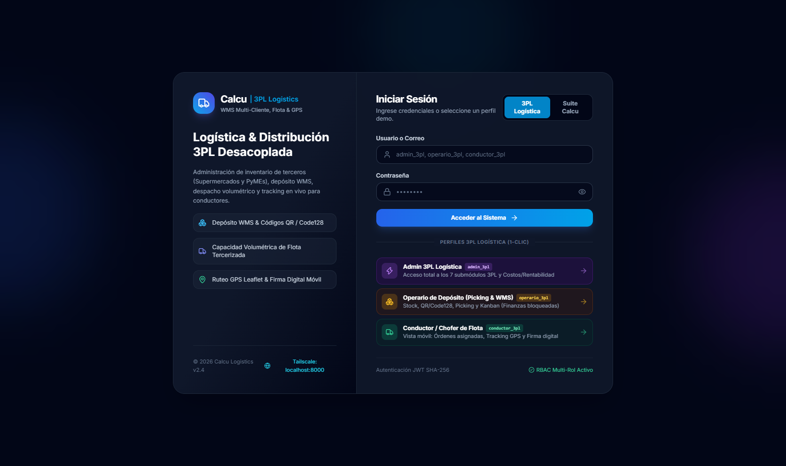

### Características del Acceso:
* **Conmutador de Entorno**: Acceso independiente para la **Suite Corporativa Calcu** o la **Unidad 3PL Logística**.
* **Perfiles Demo de Acceso Rápido**:
  * `controller_admin` / `admin`: Control total financiero, auditoría ISO 27001 y aprobaciones.
  * `admin_3pl`: Administración operativa de flota, WMS, almacén y rentabilidad de transporte.
  * `operario_3pl`: Gestión de stock, picking con lector QR/Code128 y preparación de despachos.
  * `conductor_3pl`: Interfaz móvil simplificada para entrega en ruta, geoposicionamiento y firma digital.
* **Configuración Dinámica de Servidor**: Selector integrado de nodo Tailscale para alternar entre el servidor central (`100.119.40.92:8000`) o nodos de contingencia locales.

---

## 3. Módulo de Monitoreo, Auditoría & Ciberseguridad (ISO 27001)

Este módulo centraliza la supervisión perimetral, la gobernanza de usuarios y la inteligencia de negocios impulsada por el **Copiloto Ejecutivo IA (Google Gemini / Antigravity Engine)**.

### 3.1. Dashboard Ejecutivo & Copiloto IA (6 Cuadrantes)
El panel ejecutivo consolida en tiempo real los 6 indicadores vitales de la compañía:
1. **Deudores & Mora (Aging)**: Deuda vencida total desglosada por etapas de mora.
2. **KPI de Vendedores**: Ventas totales por ejecutivo y porcentaje de cumplimiento de metas trimestrales.
3. **Asistencia & Horarios de Ingreso/Egreso**: Registro biométrico/digital de personal con geolocalización de nodo Tailscale.
4. **KPIs de Productos**: Top de volumen facturado, unidades vendidas y tasa de rotación de stock.
5. **Distribución por Formas de Pago**: Proporción entre Contado Inmediato, Crédito 30/60 días y Transferencia BROU.
6. **Medios de Compra y Canales**: Facturación originada en Portal B2B, Ventas de Campo y Adjudicaciones ARCE/SICE.

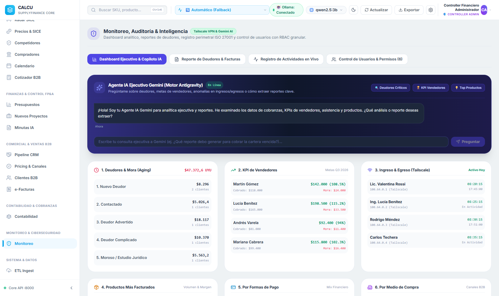

> **Copiloto IA Gemini**: Permite formular consultas en lenguaje natural (*ej. "¿Qué plan de acción recomiendas para la cartera en mora superior a 45 días?"*) y genera dictámenes inmediatos basados en los datos del sistema.

### 3.2. Reporte de Cartera y Deudores con Aging Dinámico
Tablero financiero de control de crédito con segmentación de vencimientos:
* **Filtros Inmediatos**: Segmentación a 1 día, 30 días, 45 días y 60+ días de vencimiento.
* **Detalle por Cliente**: Límite de crédito asignado, cupo remanente, días máximos de retraso y números de comprobantes fiscales adeudados.

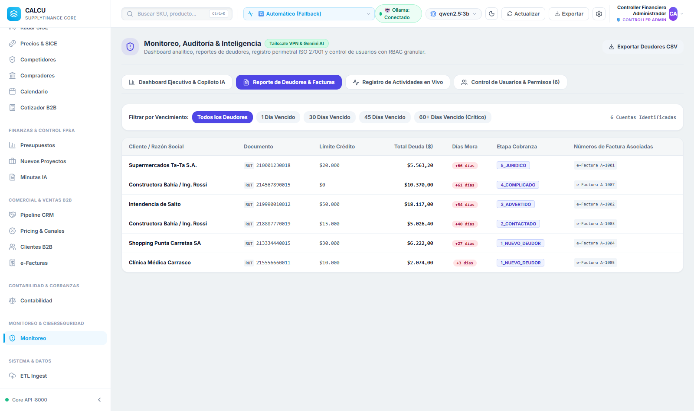

### 3.3. Auditoría Perimetral ISO/IEC 27001:2022
* Monitoreo perimetral en tiempo real que asegura que únicamente los puertos autorizados (`8000` para FastAPI, `5173` para React y `11434` para inferencia local aislada) estén activos.
* Registro inmutable de cada transacción con `user_id`, rol, acción realizada, dirección IP, ubicación y nivel de severidad (`INFO`, `WARNING`, `CRITICAL`).

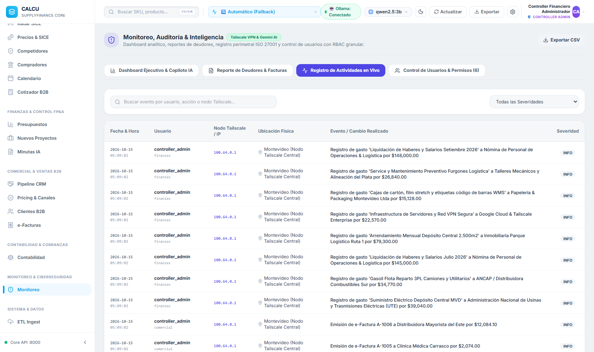

### 3.4. Control de Usuarios & RBAC Granular
* Creación y edición de usuarios con perfiles preconfigurados por puesto laboral.
* Matriz de **Denegación Explícita de Módulos**: Posibilidad de ocultar y bloquear cualquier vista específica a usuarios según su puesto.

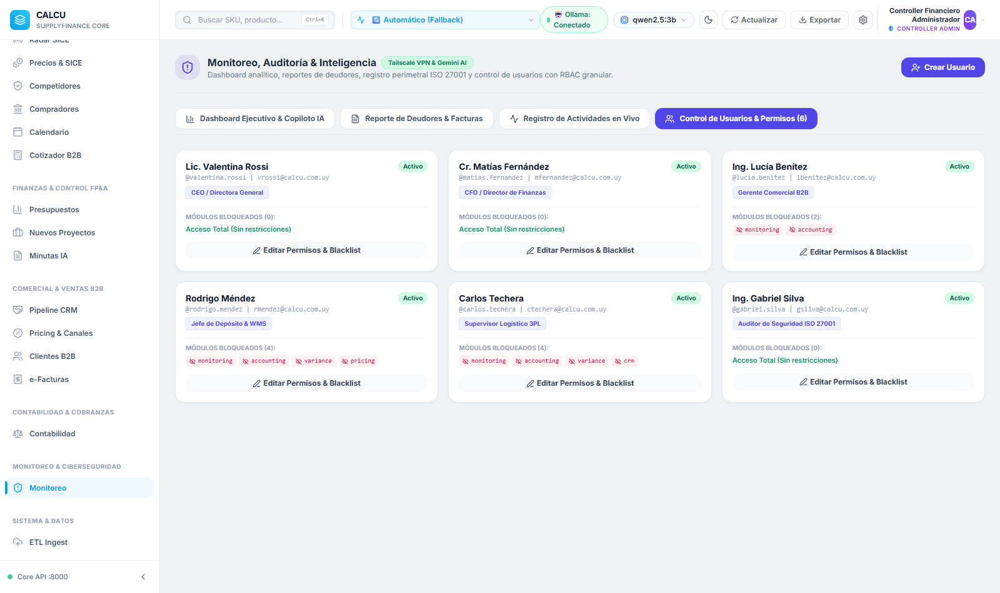

---

## 4. Módulo de Contabilidad, Cobranzas & Normativa Fiscal

### 4.1. Tablero Kanban de Cobranzas en 5 Etapas
Diseñado para eliminar la morosidad y formalizar la gestión prejudicial sin fricción:
* **Etapa 1: Nuevo Deudor (1 a 29 días vencido)**: Alerta temprana de impago.
* **Etapa 2: Contactado (30 a 44 días vencido)**: Transición automática con recordatorio formal de cobro.
* **Etapa 3: Deudor Advertido (45 a 59 días vencido)**: Suspensión preventiva de nuevas órdenes a crédito.
* **Etapa 4: Deudor Complicado (60 a 62 días vencido)**: Habilita el botón de emisión de **Intimación Legal Prejudicial**.
* **Etapa 5: Moroso / Estudio Jurídico (63+ días vencido)**: Pase directo a cobranza judicial y reclamo ejecutivo de títulos.

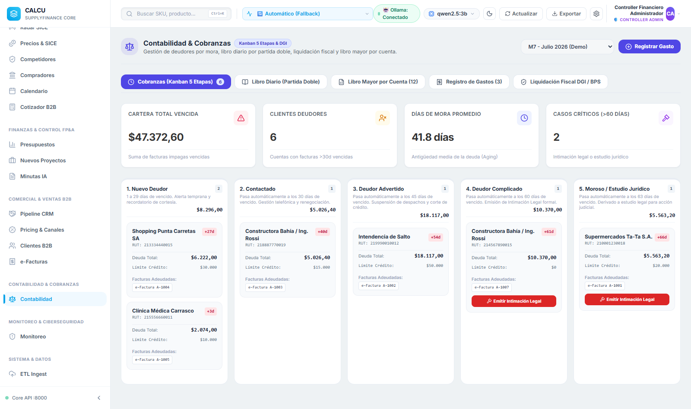

### 4.2. Generador de Intimación Legal Prejudicial (CGP Uruguay)
Genera en un clic el texto formal de intimación legal prejudicial basado en los artículos 353 y siguientes del Código General del Proceso (CGP) y el Decreto Ley 14.412 de cheques y facturas conformadas, listo para copiar o imprimir.

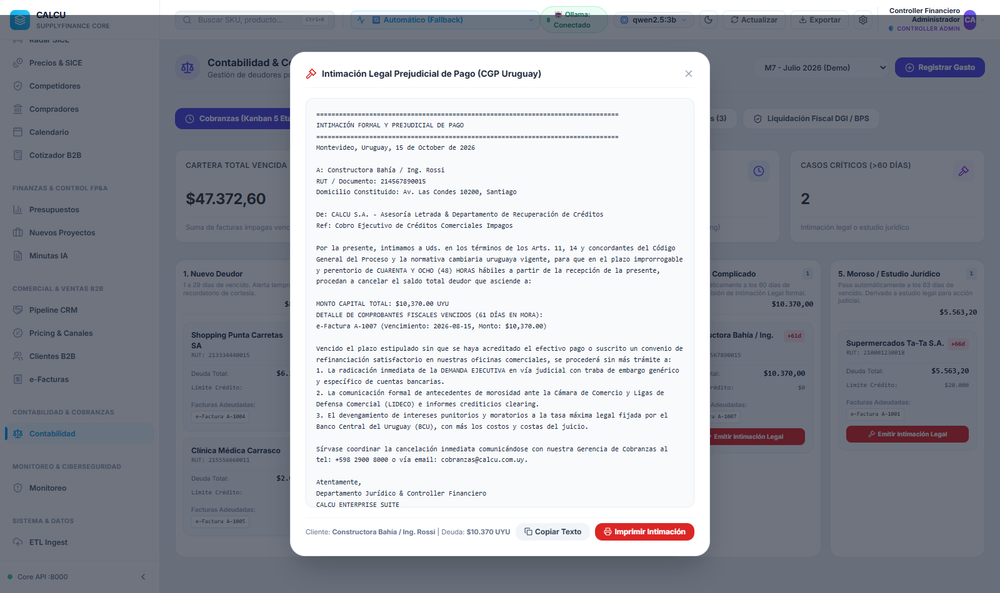

### 4.3. Libro Diario en Partida Doble Cuadrada
Registro contable riguroso bajo principio de partida doble donde cada asiento valida estrictamente `Sum(Debe) == Sum(Haber)`.

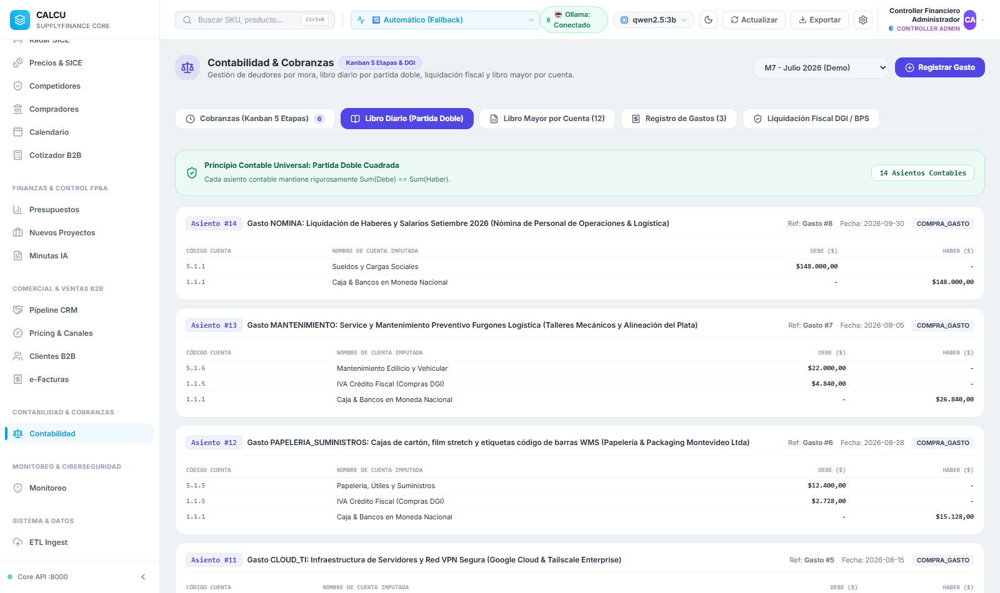

### 4.4. Libro Mayor General por Cuenta (T-Accounts)
Consolidación de saldos netos, total débitos y total créditos para cuentas de Activo, Pasivo, Patrimonio y Resultados.

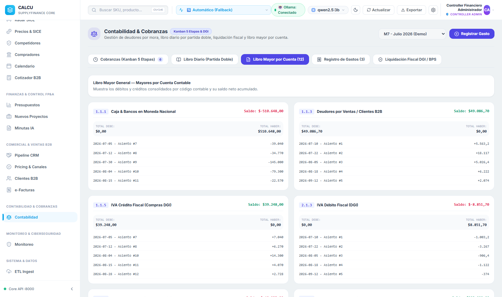

### 4.5. Liquidación Fiscal DGI / BPS y Dictamen IA
* **IVA Débito vs. IVA Crédito**: Cálculo automático de la posición neta a pagar ante la DGI.
* **Cargas Sociales BPS**: Nómina imponible, aporte jubilatorio patronal (7.5%) y FONASA patronal (5%).
* **Anticipo Mensual IRAE**: Coeficiente base sobre ventas netas del período con dictamen fiscal emitido por IA.

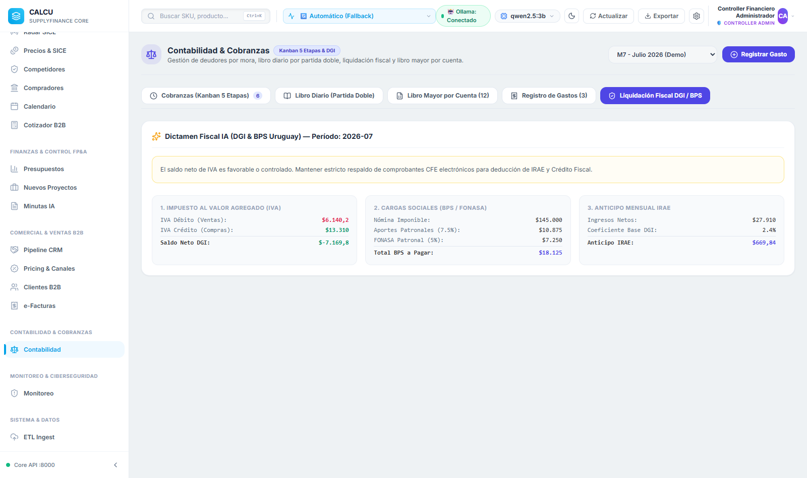

---

## 5. Módulo de Facturación B2B (Comprobantes Fiscales CFE DGI)

Cumple con la normativa uruguaya de facturación electrónica CFE:
* **e-Factura (Tipo CFE 111)**: Emisión de facturas comerciales con IVA Tasa Básica (22%) o Mínima (10%).
* **Nota de Crédito (Tipo CFE 112)**: Reversión automática de factura original con imputación contable invertida.
* **Carga desde Orden de Venta (OV)**: Importación directa de líneas de venta aprobadas desde el CRM comercial.
* **Búsqueda Predictiva (>2 Caracteres)**: Autocompletado inteligente de productos por SKU/nombre y de clientes por RUT o Razón Social.
* **Protección de Crédito para Consumidor Final**: Detección de C.I. vs. RUT con bloqueo forzoso de crédito para consumidores finales, restringiéndolos a compras de contado.

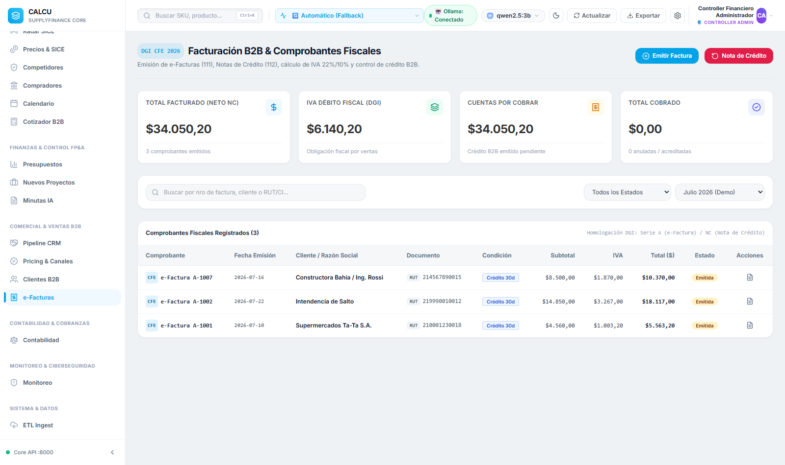
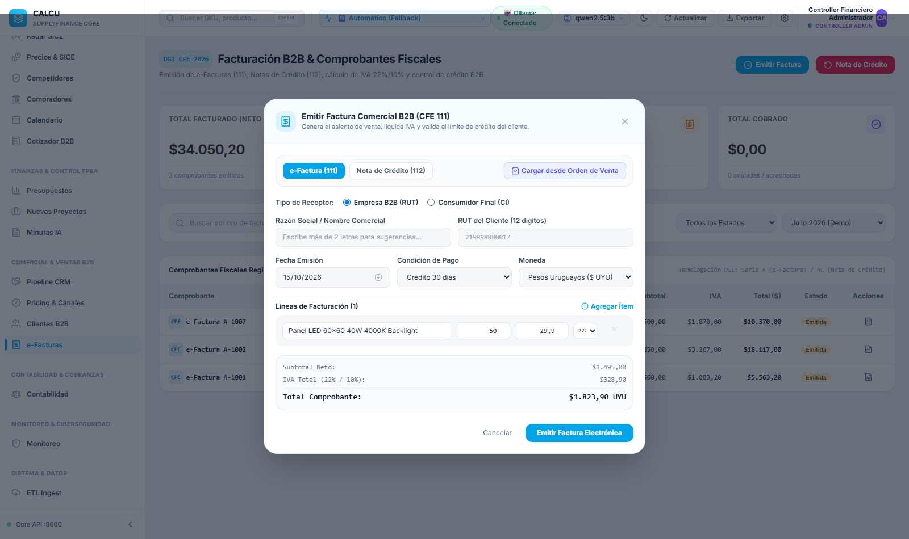

---

## 6. Unidad Desacoplada 3PL: Logística, WMS & Flota Satelital

La solución 3PL permite a empresas de transporte o depósitos tercerizados operar con total autonomía o integradas a la casa matriz.

### 6.1. Ruteo Satelital y Tracking GPS en Vivo
* Integración con mapas satelitales **Leaflet OpenStreetMap**.
* Telemetría GPS en tiempo real enviada desde la aplicación móvil de los choferes mediante WebSockets de latencia submétrica.
* Monitoreo de estado de entrega, nivel de combustible y velocidad.

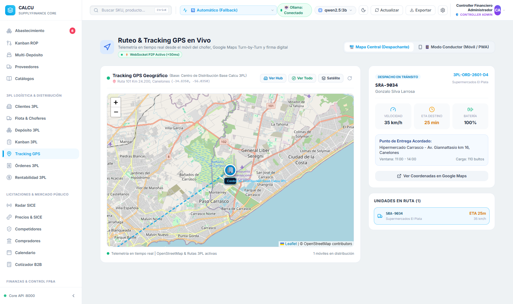

### 6.2. Depósito & Stock 3PL (WMS Multi-Cliente)
* Almacén multi-cuenta con segregación de inventario por cliente tercerizado.
* Identificación por código de barras (Code128) y códigos QR para escaneo rápido en recepción y despacho.

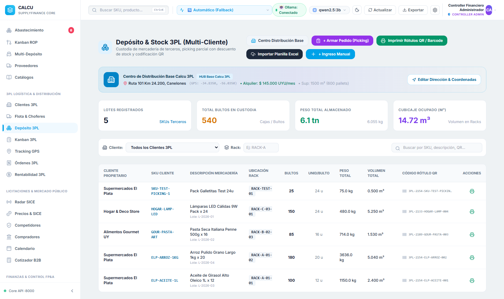

### 6.3. Kanban Operativo de Entregas & Despachos
Flujo visual de órdenes de entrega clasificadas en: *Pendiente de Asignación*, *En Carga en Depósito*, *En Tránsito*, *Entregado con Firma* e *Incidencia en Destino*.

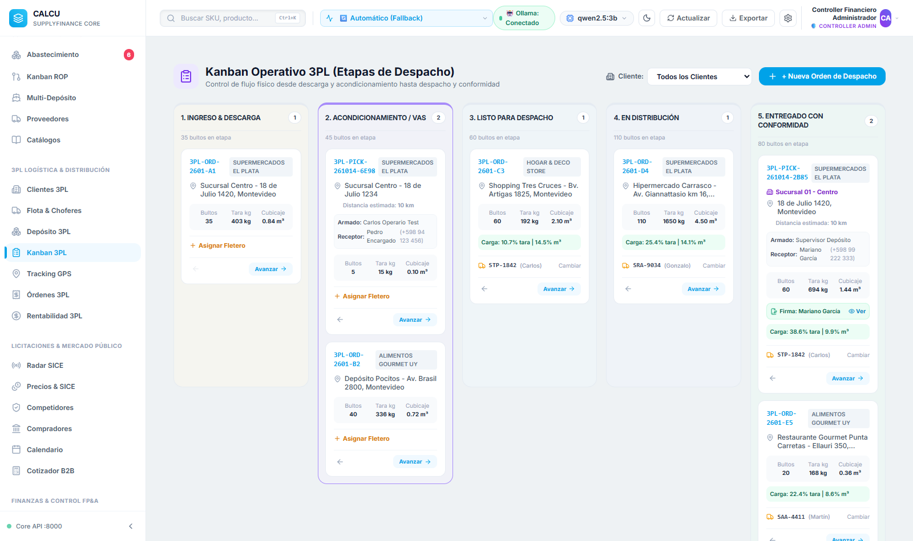

### 6.4. Análisis de Rentabilidad y Costos de Flota
Auditoría de rentabilidad por viaje, cálculo del costo real por kilómetro recorrido y margen bruto de la operación logística.

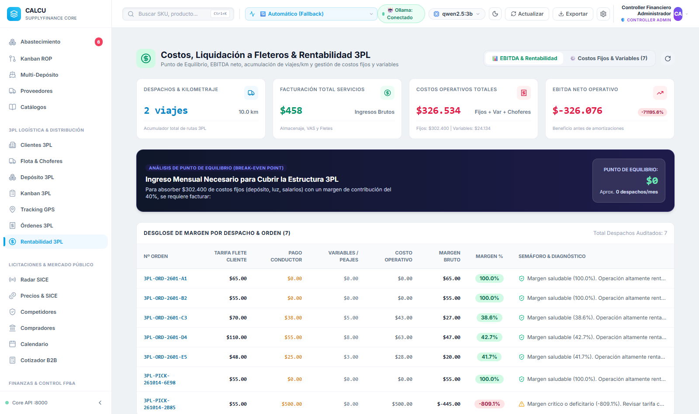

---

## 7. Supply Chain Core, Pricing & Compras Públicas

### 7.1. Control Room de Abastecimiento & DOH
Semáforo inteligente de inventario que calcula los días de inventario disponible (*Days on Hand*), detectando riesgos de quiebre de stock con semanas de antelación.

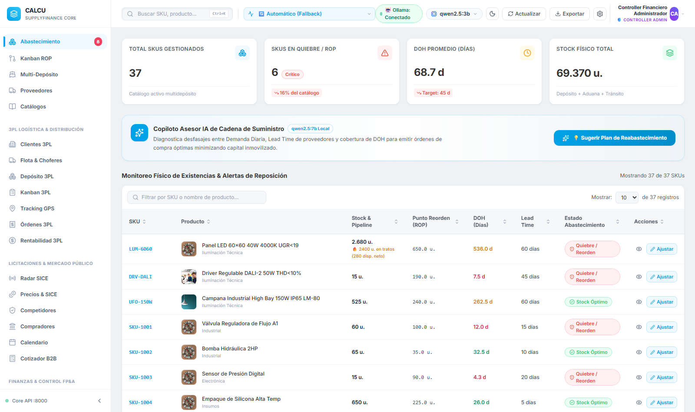

### 7.2. Pipeline Kanban de Reposición (ROP)
Etapas automatizadas de compra: *Sugerido por ROP*, *Orden Emitida*, *En Tránsito Marítimo/Terrestre*, *En Aduana MVD* y *Disponible en Depósito Central*.

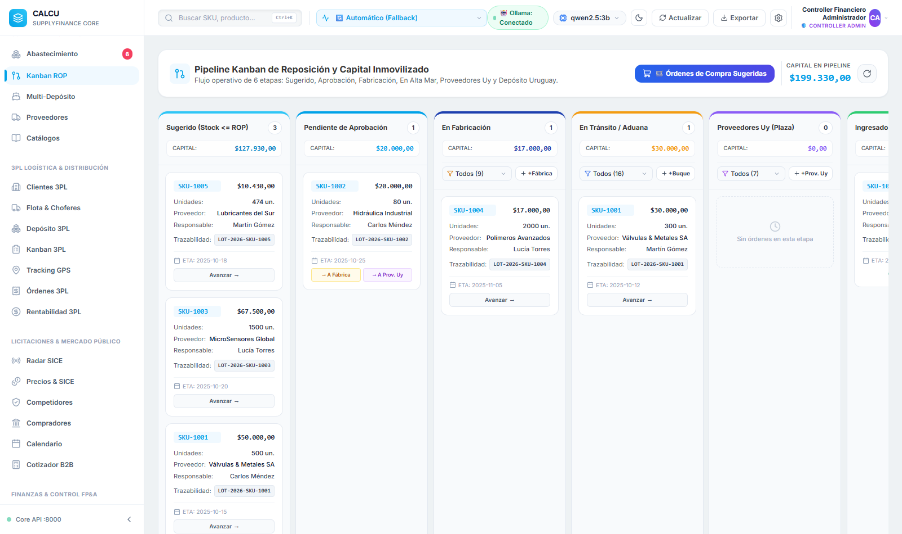

### 7.3. Pricing Dinámico & Simulador de Descuentos
Cálculo de márgenes de contribución por canal (Mayorista, Distribuidor, Consumidor Final) y simulador de sensibilidad ante variaciones del tipo de cambio BROU.

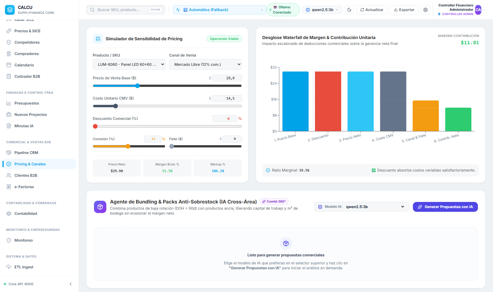

### 7.4. Radar de Licitaciones Estatales (ARCE / SICE)
Monitoreo continuo de compras estatales en Uruguay, comparación de precios históricos y cotizador de pliegos con dictamen legal y técnico automatizado.

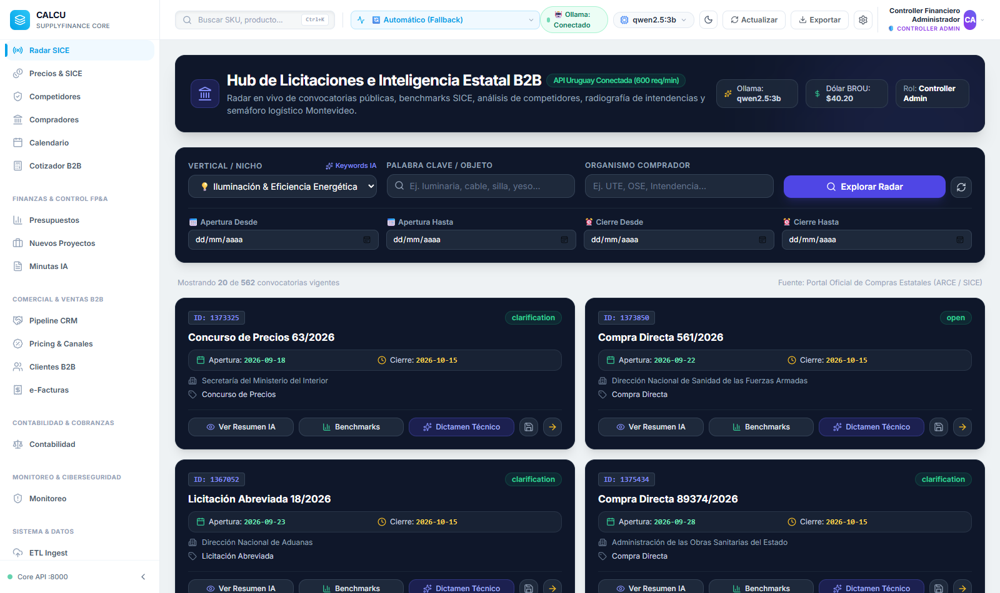

---

## 8. Aplicación Móvil Android (APK) & Despliegue en Terreno

Para choferes de flota, personal de depósito y supervisores en ruta, Calcu incluye un cliente móvil nativo compilado con **Capacitor Android**:

* **Nombre de Aplicación**: `Calcu 3PL Logistica`
* **Identificador de Paquete**: `com.calcu.logistics3pl`
* **Archivo Binario Compilado**: [`Calcu_3PL_Mobile_v2026.apk`](file:///c:/Users/sebar/OneDrive/Desktop/Calcu/Calcu_3PL_Mobile_v2026.apk) (5.94 MB)
* **Compatibilidad**: Android 10+ (API Level 29 a 35)
* **Funcionalidades Nativas**:
  * Emisión de coordenadas GPS continuas al backend en segundo plano.
  * Módulo de captura de firma digital del receptor de mercadería.
  * Escaneo de remitos y bultos mediante cámara integrada.
  * Conexión cifrada a la VPN Tailscale del nodo central sin configuración manual.

### Instrucciones de Instalación para Choferes y Operarios:
1. Copiar el archivo `Calcu_3PL_Mobile_v2026.apk` al dispositivo Android.
2. Habilitar la instalación desde fuentes desconocidas si es solicitada.
3. Abrir la aplicación: la IP de conexión Tailscale se autoconfigura al servidor corporativo.
4. Seleccionar el perfil `Conductor / Chofer` o `Operario de Depósito` para inicio inmediato.

---

## 9. Conclusión y Próximos Pasos

La suite **Calcu 2026** representa una plataforma integral probada, robusta y escalable que combina la rigurosidad contable y normativa con la agilidad logística y la automatización por inteligencia artificial.

Para solicitar una demostración guiada en vivo o coordinar la integración técnica con sus sistemas existentes, comuníquese con el equipo de soporte técnico y desarrollo de Calcu.
