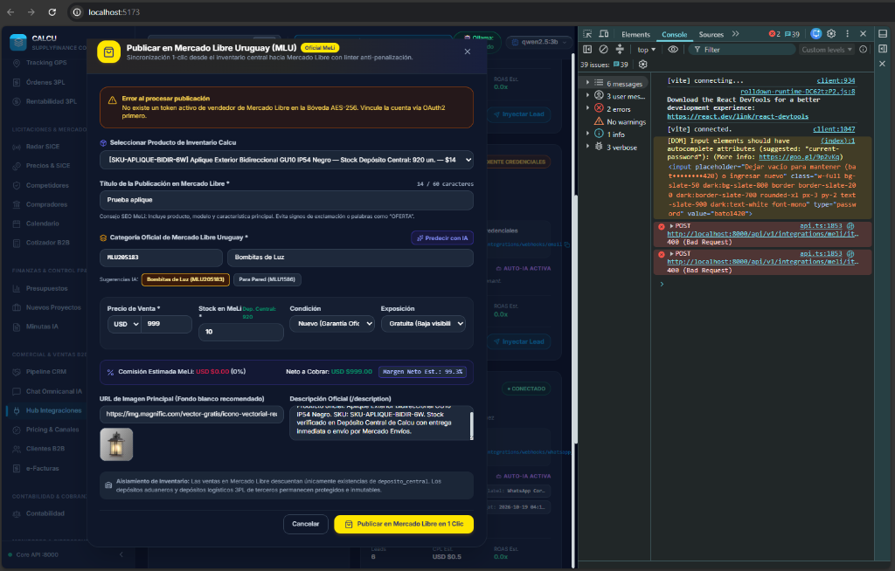
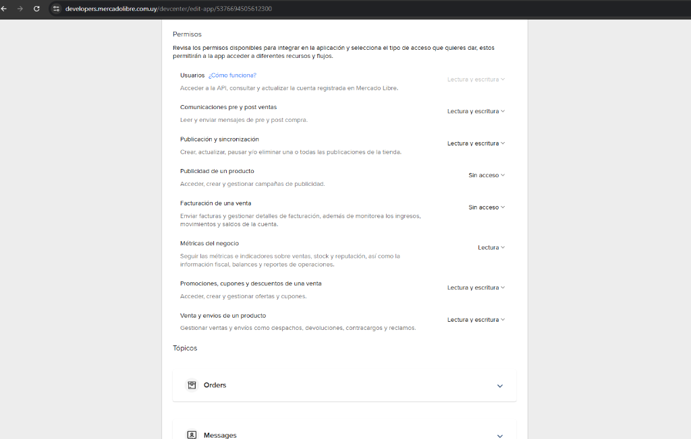
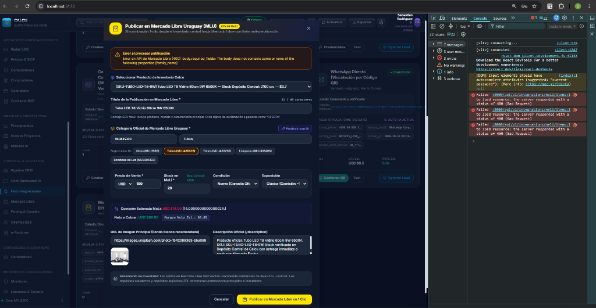
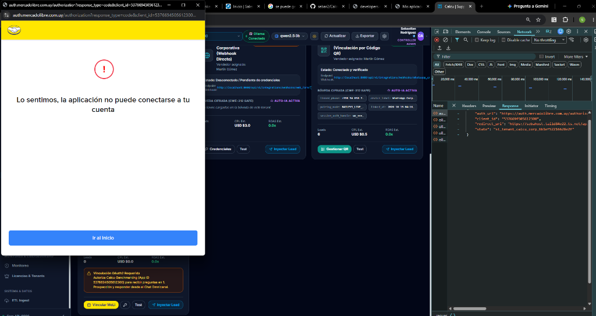

# CALCU SUITE 2026 & 3PL LOGÍSTICA
## Manual Completo e Integral del Software para Clientes y Socios Estratégicos
*Versión 2.5 Enterprise | Revisión Oficial Octubre 2026 | Arquitectura: FastAPI + React 19 + Capacitor Android + Tailscale*

---

> **Nota para el Lector**: Este manual reúne en un único documento continuo todas las funcionalidades, flujos contables y logísticos, especificaciones técnicas y 24 capturas de pantalla reales en alta resolución del sistema en funcionamiento, incluyendo las nuevas unidades de Mercado Libre Uruguay, Chat Omnicanal con WhatsApp QR y la experiencia móvil optimizada.

---

## Índice General

1. [Portal de Acceso y Red Segura Tailscale](#1-portal-de-acceso-y-red-segura-tailscale)
2. [Monitoreo, Auditoría y Dashboard Ejecutivo](#2-monitoreo-auditoría-y-dashboard-ejecutivo)
3. [Reportes Financieros y Aging de Cartera](#3-reportes-financieros-y-aging-de-cartera)
4. [Gobernanza Perimetral ISO/IEC 27001:2022](#4-gobernanza-perimetral-isoiec-270012022)
5. [Control de Usuarios y Permisos RBAC Granular](#5-control-de-usuarios-y-permisos-rbac-granular)
6. [Cobranzas Automatizadas en 5 Etapas de Mora](#6-cobranzas-automatizadas-en-5-etapas-de-mora)
7. [Generador de Intimación Legal Prejudicial (CGP)](#7-generador-de-intimación-legal-prejudicial-cgp)
8. [Libro Diario y Mayor en Partida Doble Cuadrada](#8-libro-diario-y-mayor-en-partida-doble-cuadrada)
9. [Liquidación Fiscal DGI y BPS con Dictamen IA](#9-liquidación-fiscal-dgi-y-bps-con-dictamen-ia)
10. [Facturación B2B (e-Facturas 111 y Notas de Crédito 112)](#10-facturación-b2b-e-facturas-111-y-notas-de-crédito-112)
11. [Emisión Predictiva, Órdenes de Venta y Consumidor Final](#11-emisión-predictiva-órdenes-de-venta-y-consumidor-final)
12. [Unidad 3PL: Ruteo y Tracking Satelital GPS en Vivo](#12-unidad-3pl-ruteo-y-tracking-satelital-gps-en-vivo)
13. [Unidad 3PL: WMS Depósito Multi-Cliente y Códigos QR](#13-unidad-3pl-wms-depósito-multi-cliente-y-códigos-qr)
14. [Unidad 3PL: Kanban Operativo de Entregas y Despachos](#14-unidad-3pl-kanban-operativo-de-entregas-y-despachos)
15. [Unidad 3PL: Rentabilidad y Costo por Kilómetro](#15-unidad-3pl-rentabilidad-y-costo-por-kilómetro)
16. [Supply Chain: Control Room de Abastecimiento & DOH](#16-supply-chain-control-room-de-abastecimiento--doh)
17. [Supply Chain: Pipeline Kanban de Reposición (ROP)](#17-supply-chain-pipeline-kanban-de-reposición-rop)
18. [Comercial: Pricing Dinámico y Simulación de Canales](#18-comercial-pricing-dinámico-y-simulación-de-canales)
19. [Licitaciones Estatales: Radar de Convocatorias ARCE / SICE](#19-licitaciones-estatales-radar-de-convocatorias-arce--sice)
20. [Aplicación Móvil Android (APK) y Despliegue en Terreno](#20-aplicación-móvil-android-apk-y-despliegue-en-terreno)
21. [Módulo Mercado Libre Uruguay: Kanban 5 Etapas, SLA y Logística](#21-módulo-mercado-libre-uruguay-kanban-5-etapas-sla-y-logística)
22. [Publicación Asistida MeLi: Modal Pinned y Selector de Envíos 3 Vías](#22-publicación-asistida-meli-modal-pinned-y-selector-de-envíos-3-vías)
23. [Chat Omnicanal & WhatsApp Directo QR (Multimedia & Audio PTT .Opus)](#23-chat-omnicanal--whatsapp-directo-qr-multimedia--audio-ptt-opus)
24. [Integraciones Multicanal & Atribución de Leads (ROAS/CAC)](#24-integraciones-multicanal--atribución-de-leads-roascac)
25. [Experiencia Móvil Optimizada (Menú Hamburguesa ☰ para Redmi Note 9 Pro)](#25-experiencia-móvil-optimizada-menú-hamburguesa--para-redmi-note-9-pro)
26. [Modelo de Licenciamiento, Programa Pioneros & Aislamiento Multi-Tenant](#26-modelo-de-licenciamiento-programa-pioneros--aislamiento-multi-tenant)

---

## 1. Portal de Acceso y Red Segura Tailscale

El ingreso a la plataforma se realiza mediante un portal unificado que conecta las dos unidades del negocio: la **Suite Corporativa Calcu** (abastecimiento, finanzas, comercial y licitaciones) y la **Unidad Desacoplada 3PL Logística** (depósito, tracking GPS y choferes).

### Características del Acceso:
* **Autenticación Estricta & Auditoría ISO 27001**: Acceso corporativo mediante credenciales individuales registradas en variables de entorno seguras (`.env`) con trazabilidad completa de eventos en el registro perimetral inmutable.
* **Entorno Evaluador / Modo Demo (Sandbox Aislado)**: Para prospectos y evaluadores externos, la plataforma provee el usuario `demo` con contraseña `demo123` que opera sobre una base de datos clonada e hiper-aislada (`calcu_demo.db`), impidiendo cualquier impacto sobre los datos reales o la infraestructura host.
* **Conexión Cifrada Tailscale Zero-Trust (ZTNA)**: El sistema corre sobre una red privada en malla (*mesh VPN*). No requiere abrir puertos hacia internet público. Los choferes en ruta y las terminales de depósito se comunican peer-to-peer directamente con el servidor central (`100.119.40.92:8000`).

---

## 2. Monitoreo, Auditoría y Dashboard Ejecutivo

El **Dashboard Ejecutivo** centraliza los 6 indicadores estratégicos de la empresa, integrando un **Copiloto IA conversacional impulsado por Gemini**.

### Los 6 Cuadrantes Analíticos:
1. **Deudores & Mora (Aging)**: Deuda vencida total desglosada por etapas de atraso.
2. **KPI de Vendedores**: Facturación individual y porcentaje de cumplimiento de metas trimestrales.
3. **Asistencia & Horarios de Personal**: Registro de jornada laboral con IP y nodo Tailscale de conexión.
4. **KPIs de Productos**: Top de volumen facturado, unidades comercializadas y rotación de existencias.
5. **Formas de Pago**: Proporción entre Contado Inmediato, Crédito a 30 días y Transferencia BROU.
6. **Medios de Compra**: Ventas por Portal Web B2B, Venta de Campo y Compras Públicas (ARCE/SICE).

> **Copiloto IA Gemini**: Permite al director o socio comercial escribir consultas en lenguaje natural (*ej. "¿Qué plan de acción recomiendas para la cartera en mora superior a 45 días?"*) y formula un dictamen estratégico inmediato basado en los datos reales del sistema.

---

## 3. Reportes Financieros y Aging de Cartera

El reporte detallado de cuentas por cobrar permite segmentar a los deudores según la antigüedad de su deuda.

### Funcionalidades del Reporte:
* **Filtros por Días de Mora**: Botones de filtrado rápido a **1 Día**, **30 Días**, **45 Días** o **60+ Días** de vencimiento.
* **Detalle por Cliente**: Límite de crédito asignado, saldo adeudado total, días máximos de retraso, etapa del caso en el Kanban y lista completa de números de factura pendientes.

---

## 4. Gobernanza Perimetral ISO/IEC 27001:2022

Un **agente de ciberseguridad en segundo plano** verifica continuamente los puertos abiertos en el nodo central para garantizar el estándar perimetral ISO 27001.

### Controles ISO 27001 Aplicados:
* **Control A.8.15 (Registro de Eventos)**: Bitácora inmutable de eventos con timestamp, IP, usuario, acción y severidad (`INFO`, `WARNING`, `CRITICAL`).
* **Control A.8.16 (Monitoreo de Actividades)**: Detección preventiva de puertos no autorizados fuera de la whitelist (FastAPI 8000, Vite 5173, Ollama 11434 local aislado).
* **Control A.8.20 y A.8.21 (Seguridad en Redes)**: Cifrado integral de extremo a extremo mediante Tailscale VPN.

---

## 5. Control de Usuarios y Permisos RBAC Granular

Gobierno de identidad corporativa con perfiles asignables por puesto y restricción modular selectiva.

* **Políticas de Puesto**: Presets para Analistas Comerciales, Operadores de Depósito, Controllers y Choferes.
* **Denegación Explícita de Módulos**: Los administradores pueden restringir el acceso a cualquier módulo específico (por ejemplo, ocultar finanzas o contabilidad a personal de almacén).

---

## 6. Cobranzas Automatizadas en 5 Etapas de Mora

Tablero Kanban que clasifica las facturas a crédito impagas según el envejecimiento de la deuda (*Aging Engine*):

| Etapa | Plazo de Mora | Acción Automática del Sistema |
| :--- | :--- | :--- |
| **1. Nuevo Deudor** | 1 a 29 días vencido | Ingreso automático al circuito de cobranzas y alerta preventiva. |
| **2. Contactado** | 30 a 44 días vencido | Pase automático al día 30. Generación de estado de cuenta para reclamo amistoso. |
| **3. Deudor Advertido** | 45 a 59 días vencido | Pase automático al día 45. Congelamiento inmediato de nuevas ventas a crédito. |
| **4. Deudor Complicado** | 60 a 62 días vencido | Habilitación del botón para generar la **Intimación Legal Prejudicial**. |
| **5. Moroso / Estudio Jurídico** | 63+ días vencido | Pase directo al estudio jurídico para radicación de juicio ejecutivo. |

---

## 7. Generador de Intimación Legal Prejudicial (CGP)

Al alcanzar la etapa 4 o 5 de mora, el sistema genera de forma automática el documento formal de intimación prejudicial conforme a la legislación uruguaya:

* **Fundamentación Legal**: Artículos 353 y siguientes del Código General del Proceso (CGP) y Decreto Ley 14.412.
* **Efectividad**: Otorga fuerza ejecutiva a las facturas adeudadas e intima el pago perentorio en 3 días hábiles previo al embargo y demanda civil.

---

## 8. Libro Diario y Mayor en Partida Doble Cuadrada

Cada comprobante, pago, gasto o nota de crédito genera asientos contables en tiempo real bajo la regla matemática estricta `Sum(Debe) == Sum(Haber)`.

El **Libro Mayor General** consolida débitos, créditos y saldos netos por código contable (Cuentas T):

---

## 9. Liquidación Fiscal DGI y BPS con Dictamen IA

Cálculo mensual automatizado de obligaciones tributarias en Uruguay:

* **Impuesto al Valor Agregado (IVA)**: Conciliación entre IVA Débito (22% ventas) e IVA Crédito (compras y gastos) para determinar el saldo neto a pagar a DGI.
* **Anticipo Mensual IRAE**: Coeficiente base sobre los ingresos netos facturados en el período.
* **Cargas Sociales BPS / FONASA**: Aporte patronal jubilatorio (7.5%) y FONASA patronal (5.0%) calculados sobre la nómina imponible.
* **Dictamen Fiscal IA**: Diagnóstico emitido por inteligencia artificial sobre la deducibilidad de gastos y recomendaciones de optimización.

---

## 10. Facturación B2B (e-Facturas 111 y Notas de Crédito 112)

Administración integral de Comprobantes Fiscales Electrónicos (CFE) homologables ante la DGI:

* **Comprobantes Soportados**: e-Factura Comercial (111) y Nota de Crédito de e-Factura (112).
* **KPIs en Encabezado**: Total facturado neto, IVA débito acumulado, cuentas por cobrar y facturas cobradas.

---

## 11. Emisión Predictiva, Órdenes de Venta y Consumidor Final

El formulario de emisión incorpora herramientas avanzadas para agilizar la operación y proteger el capital de trabajo:

### Características del Módulo de Emisión:
1. **Carga desde Orden de Venta (OV)**: Selector de órdenes cerradas en el CRM que puebla de forma automática cliente, RUT y renglones de producto.
2. **Búsqueda Predictiva de Clientes (>2 letras)**: Búsqueda dinámica por RUT, Cédula de Identidad, Razón Social o Nombre de Fantasía.
3. **Búsqueda Predictiva de Productos (>2 letras)**: Autocompletado con visualización de precio unitario y existencias reales en depósito.
4. **Protección de Crédito para Consumidor Final**: Si el receptor se registra con Cédula de Identidad (C.I.), el sistema inhabilita las condiciones de crédito y restringe la venta a Contado Inmediato, evitando cartera morosa incobrable.
5. **Notas de Crédito con Asiento Invertido**: Al seleccionar Nota de Crédito (112), se elige la factura a anular y el sistema revierte automáticamente la deuda y el IVA débito.

---

## 12. Unidad 3PL: Ruteo y Tracking Satelital GPS en Vivo

Cartografía interactiva en tiempo real sobre OpenStreetMap / Leaflet con telemetría de vehículos:

* **Telemetría WebSocket**: Actualización de posición GPS, velocidad y estado de entrega sin sobrecarga de red.
* **Control de Flota**: Indicadores de nivel de combustible, paradas no programadas y cálculo de hora estimada de llegada (ETA).

---

## 13. Unidad 3PL: WMS Depósito Multi-Cliente y Códigos QR

Gestión de almacén de distribución tercerizada con segregación por cuenta cliente:

* **Segregación Lógica**: Inventario diferenciado por cliente 3PL con control de pallets y volumen en m³.
* **Escaneo Inmediato**: Compatible con lectores láser y cámaras móviles para códigos Code128 y QR.

---

## 14. Unidad 3PL: Kanban Operativo de Entregas y Despachos

Flujo de trabajo para coordinar las operaciones de distribución urbana e interdepartamental:

* **Columnas del Flujo**: *Pendiente de Asignación*, *En Carga en Depósito*, *En Tránsito*, *Entregado con Firma Digital* e *Incidencia en Ruta*.

---

## 15. Unidad 3PL: Rentabilidad y Costo por Kilómetro

Auditoría financiera de la operación de transporte:

* **Margen Neto por Viaje**: Comparación entre flete cobrado y costos de combustible, peajes y jornales.
* **KPI Central**: Costo operativo real por kilómetro recorrido para cotizaciones precisas de nuevos fletes.

---

## 16. Supply Chain: Control Room de Abastecimiento & DOH

Semáforo de inventario expresado en Días de Cobertura (*Days on Hand - DOH*):

* **Semáforo DOH**: Crítico (<15 días, alerta de quiebre), Normal (15 a 45 días) y Sobrestock (>45 días, capital inmovilizado).

---

## 17. Supply Chain: Pipeline Kanban de Reposición (ROP)

Monitoreo del reabastecimiento continuo en 5 estadios:

* **Estadios**: *Sugerido por ROP*, *Orden de Compra Emitida*, *En Tránsito Marítimo/Terrestre*, *En Aduana MVD* y *Disponible en Depósito Central*.

---

## 18. Comercial: Pricing Dinámico y Simulación de Canales

Simulador de precios de venta mayorista y minorista con sensibilidad cambiaria:

* **Análisis Multicanal**: Márgenes para canales Mayorista, Distribuidor y Consumidor Final.
* **Sensibilidad Cambiaria**: Simulación del impacto de variaciones en la cotización del dólar BROU.

---

## 19. Licitaciones Estatales: Radar de Convocatorias ARCE / SICE

Inteligencia comercial para el mercado de compras públicas en Uruguay:

* **Monitoreo ARCE / SICE**: Pliegos de compras públicas abiertos con análisis de palabras clave de inclusión y exclusión.
* **Benchmark de Precios**: Historial de precios adjudicados a empresas competidoras.
* **Cotizador B2B**: Generación de ofertas con cálculo de viabilidad de stock y dictamen técnico.

---

## 20. Aplicación Móvil Android (APK) y Despliegue en Terreno

Para choferes y operarios, Calcu incluye un cliente móvil nativo Android:

| Característica | Especificación |
| :--- | :--- |
| **Archivo Binario Compilado** | `Calcu_3PL_Mobile_v2026.apk` (5.94 MB) |
| **Identificador de Paquete** | `com.calcu.logistics3pl` |
| **Framework Móvil** | Capacitor 8 + React 19 |
| **Compatibilidad** | Android 10.0 (API 29) hasta Android 15 (API 35) |
| **Hardware Integrado** | GPS en segundo plano, cámara para escaneo QR y panel táctil para firma digital |
| **Seguridad de Red** | Autoconfiguración sobre VPN Tailscale sin IPs públicas |

---

## 21. Módulo Mercado Libre Uruguay: Kanban 5 Etapas, SLA y Logística

El módulo oficial de integración con **Mercado Libre Uruguay (MLU)** conecta la tienda online de la empresa directamente con la operativa de empaque, despacho y finanzas de Calcu:

### Las 5 Etapas del Flujo Operativo:
1. **Por Preparar / Pendiente de Despacho** (`paid`, `to_be_agreed`):
   * Órdenes con cobro acreditado esperando empaque en el Depósito Central Montevideo.
   * **Reloj indicador de SLA de despacho**: Alerta visual con cuenta regresiva del tiempo exigido por Mercado Libre para despachar y evitar penalizaciones de reputación.
2. **En Tránsito / Despachado** (`shipped`, `in_transit`):
   * Paquetes entregados al correo o colecta de Mercado Envíos (ME2).
   * Enlace directo con código de seguimiento al tracking oficial de MeLi.
3. **Entregado / Concluido** (`delivered`, `completed`):
   * Órdenes recibidas conforme por el comprador.
   * Fecha de liberación de fondos en Mercado Pago y conciliación contable automática.
4. **Reclamos & Devoluciones** (`claims`, `disputed`):
   * Detección preventiva con alerta roja/ámbar. Botón de mediación para contestar al comprador antes de que el reclamo afecte la reputación MercadoLíder.
5. **Cancelado / Reembolsado** (`cancelled`):
   * Reversión automática de existencias al Depósito Central de Calcu, evitando discrepancias de stock.

### Vista Conmutable (Tablero Kanban vs. Vista Lista / Tabla):
* Mediante un selector superior, el usuario puede alternar instantáneamente entre la vista visual de tarjetas Kanban y una tabla analítica avanzada.
* **Selector de Columnas Editables**: Permite ocultar o mostrar columnas operativas (ID de Orden, Comprador, SKU, Cantidad, Tipo de Envío, Tracking) y financieras (Monto Bruto UYU/USD, Comisión MeLi retenida, Costo de Envío, Ingreso Neto Real).
* **Exportación**: Generación de remitos de despacho para colecta y exportación limpia a Excel/CSV.

---

## 22. Publicación Asistida MeLi: Modal Pinned y Selector de Envíos 3 Vías

El sistema integra un asistente de publicación masiva y unitaria en Mercado Libre Uruguay, optimizado para una carga ergonómica sin desplazamientos molestos:

### Características de la Publicación:
* **Cabecera y Botonera Fijas (*Sticky Header & Footer*)**: El título del producto, SKU y botones de acción rápida permanecen anclados a la vista, mientras que el cuerpo del formulario cuenta con scroll vertical fluido adaptado a cualquier resolución.
* **Selector Logístico de 3 Vías**:
  1. *Mercado Envíos (ME2)*: Permite configurar si el envío es gratuito para el comprador o si se traslada el costo del flete oficial calculado automáticamente por MeLi en el checkout.
  2. *Costos de Envío Personalizados (Logística Propia)*: Casillas independientes para ingresar el costo fijo de flete para **Montevideo** y para el **Interior del país**, permitiendo rentabilizar la flota propia 3PL de la empresa.
  3. *A Convenir con el Comprador*: Modalidad de retiro en Depósito Central Calcu o coordinación particular.
* **Recuperación Automática de Categoría**: Si la categoría seleccionada en MeLi no admite costos personalizados, el motor reintenta automáticamente bajo la modalidad compatible sin truncar la publicación.

---

## 23. Chat Omnicanal & WhatsApp Directo QR (Multimedia & Audio PTT .Opus)

El centro de atención omnicanal unifica en una única consola todas las conversaciones comerciales con clientes procedentes de WhatsApp, Mercado Libre, Email y formularios web:

### Capacidades Multimedia & Ergonomía del Chat:
* **Vinculación Directa por Código QR**: Conexión nativa con el número propio de la empresa mediante escaneo QR, sin pagar tarifas por mensaje ni requerir APIs de terceros.
* **Intercambio Multimedia Bidireccional**: Envío y recepción en vivo de imágenes, videos y notas de voz PTT.
* **Motor de Audio Nativo `.opus` Mono a 48 kHz**: Transcodificación interna asistida por `ffmpeg-static` que garantiza que los audios y notas de voz grabados o enviados desde la plataforma se escuchen de forma 100% nativa en smartphones (Android e iOS).
* **Copiado y Pegado Directo (`Ctrl + V`)**: Permite capturar la pantalla con `Win + Shift + S` o copiar archivos de video/audio en el explorador de Windows y pegarlos directamente dentro del campo de texto, visualizando una miniatura flotante sin bloquear la redacción del mensaje.
* **Arrastrar y Soltar (*Drag & Drop*)**: Zona de impacto visual sobre la caja de redacción para soltar archivos de hasta 50 MB.
* **Agente IA con Lectura de Stock en Tiempo Real**: El copiloto analiza el contexto de la consulta, verifica existencias y precios en el catálogo de Calcu y propone respuestas ejecutivas listas para enviar con un clic.
* **Filtro Anti-Penalización MeLi**: Escudo activo que bloquea accidentalmente números de teléfono o correos electrónicos en preguntas pre-venta de Mercado Libre.

---

## 24. Integraciones Multicanal & Atribución de Leads (ROAS/CAC)

Tablero centralizado de canales de adquisición comercial que monitorea la procedencia de cada prospecto que ingresa al CRM:

* **Canales Conectados**: WhatsApp QR, Meta Ads (Facebook/Instagram), Google Ads, Email Corporativo, Webhook Web Form y Mercado Libre.
* **Métricas Financieras en Tiempo Real**: Costo por Lead (CPL), Retorno del Gasto Publicitario (ROAS) y Costo de Adquisición de Clientes (CAC) calculados a partir de los negocios ganados en el CRM.
* **Sincronización Web**: Los prospectos que completan el formulario en la web de GitHub Pages ingresan en tiempo real como tratos y mensajes bajo el canal `WEB_FORM`.

---

## 25. Experiencia Móvil Optimizada (Menú Hamburguesa ☰ para Redmi Note 9 Pro)

Calcu Suite 2026 ha sido optimizada para smartphones de alta gama y pantallas panorámicas 20:9, como el **Xiaomi Redmi Note 9 Pro** corriendo **LineageOS 22.2 (Android 15)**:

* **Menú Hamburguesa (☰)**: En resoluciones móviles (< 1024px), el sidebar tradicional se oculta automáticamente y es sustituido por un icono de tres líneas horizontales apiladas en el TopHeader.
* **Navegación en Drawer Deslizable (*Off-Canvas*)**: Al tocar el menú ☰, se despliega un panel lateral suave con fondo oscuro translúcido (*backdrop touch*). Al seleccionar cualquier módulo o tocar el fondo, el menú se repliega de forma instantánea.
* **Aprovechamiento Integral de Pantalla**: Eliminación de márgenes forzados para que las tarjetas analíticas, órdenes y mapas de ruteo ocupen el 100% del ancho del terminal sin recortes.

---

## 26. Modelo de Licenciamiento, Programa Pioneros & Aislamiento Multi-Tenant

Calcu opera bajo una arquitectura **SaaS Multi-Tenant con Aislamiento Estricto**, diseñada para proteger la confidencialidad de la información de cada empresa:

### Aislamiento de Datos por Licencia:
* **Base de Datos Exclusiva & Respaldada**: Cada empresa cliente dispone de un esquema/base de datos independiente y cifrada, con copias de seguridad automáticas y sin mezcla de tablas.
* **Control de Identidad & RBAC**: Políticas de roles y denegación modular configurables desde la consola Master Admin.

### Política Comercial & Programa Pioneros:
1. **Primeros 20 Clientes Estratégicos (Programa Pioneros)**:
   * **100% Gratuito**: Acceso completo y sin costo al software mientras culmina la programación de todos los módulos del ecosistema.
   * **Tarifa Especial de por Vida (*Lifetime Partner*)**: Precio preferencial bonificado y congelado de forma permanente para crecer juntos con el socio comercial.
2. **Clientes Posteriores (Cliente 21 en adelante)**:
   * **Período de Prueba Gratuito**: Demo de 14 días con datos reales o sandbox, ampliable hasta 1 mes a solicitud del equipo directivo.
   * **Licenciamiento Modular Flexible**: Pago mensual escalable únicamente por los módulos y herramientas que la empresa active (Logística 3PL, Supply Chain, Contabilidad DGI/BPS, Licitaciones, Omnicanal WhatsApp/MeLi).

---

## Archivos Entregables

1. **PDF Oficial de Presentación**: `MANUAL_COMPLETO_CALCU_2026.pdf` (imprimible en formato A4 con 24 capturas de pantalla de alta resolución).
2. **HTML Interactivo Autocontenido**: `docs/MANUAL_COMPLETO_CALCU_2026.html` (con estilos modernos y navegación fluida).
3. **Documento Markdown Maestro**: `docs/MANUAL_COMPLETO_CALCU_2026.md`.
4. **Aplicación Android Móvil Compilada**: `Calcu_3PL_Mobile_v2026.apk` (5.95 MB, lista para instalación en Android 10 a 15).
