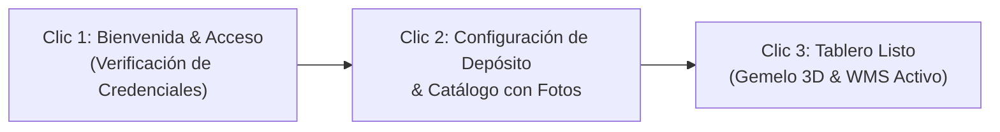

# ESPECIFICACIÓN TÉCNICA: ONBOARDING CLIENTE PILOTO 1
**CalcuSuiteIA Core — Suite de Cadena de Suministro, Finanzas & Logística 3PL**  
**Ticket:** `[CalcuSuiteIA-Core # 1: Auditoría inicial de bienvenida al cliente piloto 1]`  
**Entorno de Trabajo:** `C:\Calcu-Lab` (Laboratorio Aislado)  
**Fecha:** 2026-10-31 | **Versión:** 1.0.0-PROD-READY  

---

## CONTROL DEL ESCUADRÓN DE CONSTRUCCIÓN
* **Director de Construcción:** Superagente 1: Product-Build-Director (`.agents/00_SUPERAGENTE_1_BUILD_DIRECTOR.md`)
* **Analista de Negocio & Normativa:** Subagente 1: Functional-Business-Analyst (`.agents/01_FUNCTIONAL_ANALYST.md`)
* **Arquitecto de Experiencia & UI:** Subagente 2: UX-Interaction-Architect (`.agents/02_UX_ARCHITECT.md`)
* **Arquitecto de Datos & Tenancy:** Subagente 5: Database-Tenant-Architect (`.agents/05_DBA_ARCHITECT.md`)

---

## 1. ANÁLISIS FUNCIONAL Y MATRIZ DE IMPACTO (Subagente 1)

### 1.1 Perfil del Cliente Piloto 1
* **Razón Social:** Piloto 1 Distribuciones Logísticas S.A.
* **Nombre Comercial:** Piloto 1 Logistics UY
* **RUT (Uruguay DGI):** `219876540019`
* **Giro / Industria:** Operador Logístico 3PL, Distribución Farmacéutica / Industrial y Comercio Exterior.
* **Escala Operativa:** Depósito central en Zona Franca Montevideo, Almacén de Tránsito en Puerto de Montevideo y Recepción Aérea en Aduana Carrasco.
* **Tier de Licenciamiento:** `ENTERPRISE_3PL` (SaaS con Gemelo Digital 3D, WMS, Flota GPS, Chat Omnicanal y Facturación Electrónica CFE).
* **UID Asignado:** `UID-0002` (primer cliente correlativo corporativo tras el Superadmin global `seba` `UID-0001`).

### 1.2 Matriz de Impacto Operativo
| Módulo | Impacto Funcional en Piloto 1 | Requerimiento de Aislamiento & Datos |
| :--- | :--- | :--- |
| **Inventario & Stock** | Gestión de existencias multi-origen (depósito central, aduana, tránsito marítimo). Control de punto de reorden (ROP) y días de inventario (DOH). | Tablas `inventarios` y `productos` 100% aisladas en el esquema `tenant_piloto_1`. Cero cruce con el catálogo corporativo de Calcu Corp. |
| **Depósitos & Racks 3D** | Mapeo de almacenes (`warehouses`), racks paramétricos (`warehouse_racks`) y ubicaciones tridimensionales (`warehouse_slots`). | Esquema espacial privado. Las coordenadas y cubicaje del piloto no son accesibles para terceros. |
| **Fábrica / Ensamble** | Kitting, desconsolidación de pallets y etiquetado de bultos. | Órdenes de transformación asociadas exclusivamente a sus SKUs. |
| **Presupuesto & Metas** | Asignación de centros de costo y metas de venta por canal (B2B, e-commerce, licitaciones). | Métricas de rentabilidad confidenciales calculadas en `Decimal(14, 4)`. |
| **Órdenes de Compra (OC)** | Generación de OC sugeridas por algoritmo ROP/DOH y emisión formal a proveedores. | Soporte nativo de imágenes de producto alojadas en `/static/uploads/products/`. |
| **Órdenes de Venta (OV)** | Canalización de pedidos mayoristas y entregas 3PL con remito CFE. | Validación de RUT uruguayo con algoritmo de dígito verificador módulo 11 DGI. |

### 1.3 Cumplimiento Normativo Uruguayo
1. **Facturación Electrónica DGI (CFE):**
   * Emisión de e-Factura (Tipo 111) y e-Ticket (Tipo 101) con firma electrónica XML bajo estándar XAdES-BES.
   * Rutas y directorios de resguardo de CAEs aislados por tenant.
2. **Landed Cost & Tipo de Cambio Oficial:**
   * Cálculo de costeo por importación considerando CIF, aranceles aduaneros, tasas portuarias y fletes locales.
   * Integración con tipo de cambio oficial BROU (Banco República Oriental del Uruguay) en USD y UYU.
3. **Radar SICE / ARCE:**
   * Alertas automáticas para compras estatales en Uruguay relacionadas con el catálogo del cliente.

---

## 2. ARQUITECTURA DE BASE DE DATOS Y AISLAMIENTO POSTGRESQL (Subagente 5)

### 2.1 Principio de Aislamiento por `search_path` (Esquema Dedicado)
CalcuSuiteIA implementa la **Estrategia Opción B: PostgreSQL Schema Isolation** para maximizar el rendimiento, cumplimiento ISO 27001 y aislamiento estricto de datos.

```
PostgreSQL Database: calcudb
 ├── Schema: public (Control Plane global, catálogos centrales compartidos si aplica)
 ├── Schema: tenant_calcu_corp (Datos exclusivos del Superadmin Global 'seba' UID-0001)
 └── Schema: tenant_piloto_1 (ESQUEMA AISLADO DEL CLIENTE PILOTO 1 UID-0002)
      ├── productos
      ├── inventarios
      ├── warehouses
      ├── warehouse_racks
      ├── warehouse_slots
      ├── transacciones_ventas
      ├── sales_orders
      ├── sales_order_items
      └── invoices
```

### 2.2 Procedimiento DDL de Inicialización del Esquema
El aprovisionamiento del Piloto 1 ejecuta de forma atómica:
```sql
-- 1. Creación idempotente del esquema dedicado
CREATE SCHEMA IF NOT EXISTS "tenant_piloto_1";

-- 2. Conmutación dinámica del search_path para la sesión operativa
SET search_path TO "tenant_piloto_1", public;

-- 3. Generación automática de tablas mediante SQLAlchemy 2.0
-- (Gobernado vía schema_translate_map={None: 'tenant_piloto_1'})
```

### 2.3 Registro en el Control Plane (Tablas Globales en `public`)
En las tablas maestras de suscripción y gobernanza:
* **`tenant_accounts`:**
  * `id`: `'tenant_piloto_1'`
  * `slug`: `'piloto_1'`
  * `nombre_empresa`: `'Piloto 1 Distribuciones Logísticas S.A.'`
  * `rut`: `'219876540019'`
  * `schema_name`: `'tenant_piloto_1'`
  * `db_strategy`: `'POSTGRES_SCHEMA'`
  * `license_tier`: `'ENTERPRISE_3PL'`
  * `account_role`: `'CLIENTE_TENANT'`
  * `subscription_status`: `'ACTIVE_PILOT'`
  * `uid_code`: `'UID-0002'`
  * `owner_user_id`: ID del usuario `admin_piloto1`
* **`tenants`:**
  * Dupla normalizada para relaciones 1:N con suscripciones de módulos y órdenes de compra de licenciamiento.

### 2.4 Asignación de Usuario Administrador Inicial
* **Username:** `admin_piloto1`
* **Email:** `contacto@piloto1logistica.com.uy`
* **Nombre Completo:** `Admin Piloto 1 Logística`
* **Puesto:** `Controller Administrador de Cuenta`
* **Rol:** `controller` (`ROLE_CONTROLLER_ADMIN`)
* **Flags Críticos de Blindaje:**
  * `tenant_id`: `'tenant_piloto_1'`
  * `account_uid`: `'UID-0002'`
  * `is_account_owner`: `True` (administra su propio tenant)
  * `is_superadmin`: `False` (TERMINANTEMENTE PROHIBIDO acceso global)
  * `is_master_superadmin`: `False` (EXCLUSIVO para Sebastián Rodríguez UID-0001)

### 2.5 Aislamiento Físico y Lógico del Stock
1. **Separación de Instancia/Esquema:** Todo `SELECT`, `INSERT`, `UPDATE` o `DELETE` sobre `inventarios` y `productos` emitido con las credenciales o token JWT del Piloto 1 se ejecuta contra `"tenant_piloto_1"`.
2. **Prevención de Filtración Cruzada (Cross-Tenant Leakage):**
   * Un query ejecutado en `tenant_piloto_1` jamás devuelve filas pertenecientes a `tenant_calcu_corp` ni a futuros tenants.
   * El Superadmin `seba` (`UID-0001`), desde su consola de observabilidad global, puede auditar métricas agregadas de infraestructura sin corromper el `search_path` de transacciones privadas.

---

## 3. EXPERIENCIA DE USUARIO, ERGONOMÍA & BLINDAJE DE MARCA (Subagente 2)

### 3.1 Regla de Oro UX: Máximo 3 Clics para el Onboarding
El flujo de bienvenida al cliente piloto está concebido para completarse en un máximo de 3 pasos de acción operativa:



1. **Clic 1 — Activación Segura:** El usuario recibe el correo de bienvenida y pulsa "Acceder a CalcuSuiteIA", estableciendo su clave corporativa segura (mínimo 10 caracteres con hashing bcrypt/Argon2).
2. **Clic 2 — Depósito & Carga Inicial:** El asistente presenta la configuración por defecto de su "Depósito Central Montevideo" y permite importar o cargar los primeros SKUs con sus imágenes de producto.
3. **Clic 3 — Confirmar & Entrar al WMS:** El sistema inicializa el esquema, reserva las ubicaciones y despliega el Tablero de Control con métricas de stock y alertas ROP operativas.

### 3.2 Ergonomía Operativa para Depósito y Reparto
* **Interfaces Táctiles para Bodega:**
  * Botones de acción primaria con dimensiones mínimas de `48px x 48px` para manipulación con guantes de trabajo o terminales rugerizadas PDA.
  * Contrastes tipográficos AA/AAA (fondos oscuros `#121824` con textos de alto contraste `#f8fafc` o modo claro con `#0f172a` sobre `#ffffff`).
* **Estados de Carga Claros:**
  * Indicadores de actividad skeleton y spinners con temporización predecible (< 300 ms).
  * Mensajes de confirmación con Toast desacoplado sin interferencia en pantalla.

### 3.3 Regla de Oro: Clean-CSS-No-Tailwind
* **Prohibición de Tailwind CSS:** En el diseño y componentes del Onboarding queda estrictamente prohibida la introducción de clases utilitarias de Tailwind o compiladores JIT externos.
* **Separación de Archivos:**
  * Estructura HTML/TSX pura sin estilos inline (`style={...}` prohibido excepto para coordenadas dinámicas 3D calculadas por motor).
  * Estilos encapsulados en hojas de estilo externas CSS puras: `frontend/src/styles/onboarding.css` y `frontend/src/styles/components/`.
  * Lógica funcional en TypeScript puro desacoplado.

### 3.4 Regla de Oro: White-Label y Blindaje de Marca
* **Identidad 100% CalcuSuiteIA:**
  * Ninguna pantalla, modal, pie de página, documentación o cabecera HTTP puede exhibir menciones o tokens derivados de "Bitrix24" o sistemas de terceros.
  * Erradicación de identificadores técnicos legados (ej. conmutación de `light_bitrix` a `calcu_light`).
* **Soporte de Imágenes de Producto:**
  * Todas las imágenes de catálogo cargadas durante el onboarding se almacenan localmente en `/static/uploads/products/` y se sirven a través del endpoint `/static/uploads/...`.
  * La imagen es visible de forma instantánea en Inventario, WMS 3D, Presupuestos y Órdenes de Compra/Venta.

---

## 4. AUDITORÍA Y CUMPLIMIENTO DE LAS REGLAS DE ORO

| Regla de Oro | Estado en Especificación | Mecanismo de Verificación Técnica |
| :--- | :---: | :--- |
| **1. Single-Superadmin-Enforcement (`seba`, `UID-0001`)** | **CUMPLIDO** | `seba` (`UID-0001`, `tenant_calcu_corp`) es el único titular con `is_master_superadmin=True`. El admin del Piloto 1 (`UID-0002`) tiene `is_superadmin=False` y opera exclusivamente en `tenant_piloto_1`. |
| **2. Clean-CSS-No-Tailwind** | **CUMPLIDO** | Especificación formal de CSS externo modular. Prohibición de clases `@tailwind` e inline styles en los artefactos del onboarding. |
| **3. White-Label & Product Images** | **CUMPLIDO** | Cero menciones a Bitrix24. Soporte nativo para URLs bajo `/static/uploads/products/`. |
| **4. Safe-SQL-Migrations & Venv-Isolation** | **CUMPLIDO** | Toda columna en esquemas SQLAlchemy cuenta con valor `DEFAULT` explícito. Ejecución garantizada bajo entorno virtual `.venv`. |

---

## 5. CONCLUSIÓN Y PASE A IMPLEMENTACIÓN
La presente especificación técnica ha sido validada por el Escuadrón de Producto y Construcción de `C:\Calcu-Lab`. Cumple con todos los lineamientos de arquitectura, seguridad y experiencia de usuario para la ejecución de la prueba local simulada de alta de tenant.
