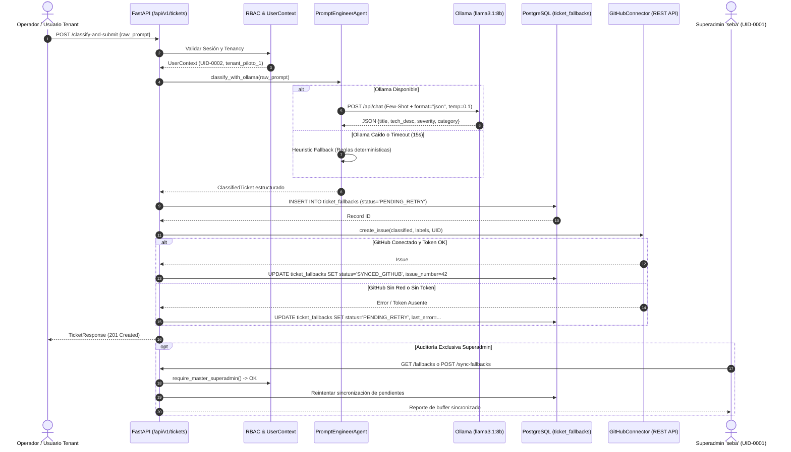

# BLUEPRINT TÉCNICO OFICIAL: MÓDULO DE TICKETS BLINDADO CON OLLAMA (LLAMA 3.1:8B) Y GITHUB API
**CalcuSuiteIA Core — Módulo de Soporte Técnico, Monitoreo de Incidencias & Buffer de Resiliencia**  
**Entorno de Operación:** `C:\Calcu-Lab` (Laboratorio Aislado de Desarrollo)  
**Fecha:** 2026-10-31 | **Versión:** 1.0.0-PROD-READY  

---

## CONTROL DEL ESCUADRÓN DE CONSTRUCCIÓN
* **Director de Construcción:** Superagente 1: Product-Build-Director (`.agents/00_SUPERAGENTE_1_BUILD_DIRECTOR.md`)
* **Analista de Negocio & Normativa:** Subagente 1: Functional-Business-Analyst (`.agents/01_FUNCTIONAL_ANALYST.md`)
* **Arquitecto de Experiencia & UI:** Subagente 2: UX-Interaction-Architect (`.agents/02_UX_ARCHITECT.md`)
* **Arquitecto de Datos & Tenancy:** Subagente 5: Database-Tenant-Architect (`.agents/05_DBA_ARCHITECT.md`)
* **Ingeniero de Prompts Especializado:** Subagente 7: Prompt-Engineer (`.agents/07_PROMPT_ENGINEER.md`)

---

## RESPETO DE LAS CUATRO REGLAS DE ORO
1. **Single-Superadmin-Enforcement (`seba`):** El usuario `seba` (`UID-0001`, esquema `tenant_calcu_corp`) es el único propietario y superadministrador global con autorización exclusiva para auditar el buffer de fallbacks (`/fallbacks`) y disparar la resincronización de tickets (`/sync-fallbacks`). Los usuarios tenant solo pueden reportar incidencias bajo su propio `tenant_id` y `reporter_uid`.
2. **Clean-CSS-No-Tailwind:** Este módulo backend expone APIs REST y esquemas Pydantic v2 estructurados. Todo futuro componente frontend consumirá las APIs utilizando CSS puro desacoplado, sin Tailwind ni estilos incrustados.
3. **White-Label & Product Images:** Identidad 100% CalcuSuiteIA. Cero referencias a marcas o plataformas externas incompatibles. Todas las incidencias se etiquetan bajo el espacio de nombres `calcusuite-ia`.
4. **Safe-SQL-Migrations & Venv-Isolation:** La tabla de resiliencia `ticket_fallbacks` define valores `DEFAULT` en todas sus columnas no anulables (`nullable=False`). Las librerías (`httpx`, `pydantic`, `sqlalchemy`, `pytest`) operan en el entorno virtual `.venv`.

---

## 1. ROL Y TAREAS DEL PROMPT ENGINEER AGENT (Subagente 7)

### 1.1 Misión del Subagente 7
El **Subagente de Prompt Engineering** (`.agents/07_PROMPT_ENGINEER.md`) tiene como objetivo garantizar que el modelo de lenguaje de inferencia local (`llama3.1:8b` ejecutado en Ollama) se comporte como un clasificador técnico determinístico de soporte empresarial de nivel L3, erradicando alucinaciones, respuestas conversacionales o formato JSON inválido.

### 1.2 System Prompt Blindado
El System Prompt ha sido diseñado bajo estrictas restricciones gramaticales y formato estructurado:

```text
You are CalcuSuiteIA's Senior Technical Issue Classifier Agent, operating in an enterprise ERP, WMS 3D, and 3PL logistics ecosystem.
Your task is to analyze user bug reports, operational exceptions, or feature requests and convert them into a strict, valid JSON object.

STRICT OUTPUT RULES:
1. Output ONLY a valid JSON object matching the exact schema below.
2. Do NOT write markdown code fences (```json or ```). Do NOT include greetings, conversational filler, or explanations before or after the JSON.
3. Allowed 'severity' values: 'LOW', 'MEDIUM', 'HIGH', 'CRITICAL'.
4. Allowed 'category' values: 'CORE_API', 'FRONTEND_UX', 'WMS_3D', 'DATABASE', 'SECURITY_AUTH', 'INTEGRATIONS', 'LOGISTICS_3PL', 'GENERAL'.
5. The 'title' must start with an uppercase category tag like [WMS-3D], [SECURITY-AUTH], [CORE-API], [DATABASE], etc.
6. Return 'technical_description' in concise, professional engineering Spanish.

SCHEMA SPECIFICATION:
{
  "title": "[CATEGORY] Concise Technical Summary",
  "technical_description": "Root cause analysis, system component affected and expected vs actual behavior.",
  "severity": "LOW" | "MEDIUM" | "HIGH" | "CRITICAL",
  "category": "CORE_API" | "FRONTEND_UX" | "WMS_3D" | "DATABASE" | "SECURITY_AUTH" | "INTEGRATIONS" | "LOGISTICS_3PL" | "GENERAL",
  "suggested_labels": ["label1", "label2"]
}
```

### 1.3 Few-Shot Prompting en Contexto (Ejemplos Calibrados)
Para condicionar los pesos de atención del modelo sin recurrir a fine-tuning, se inyectan 3 pares de entrenamiento en contexto (*few-shot*):

* **Ejemplo 1 (WMS 3D / WebGL):**
  * *Entrada Operador:* `"Al ubicar un pallet de 1.2m en el rack B-04 el visor tridimensional se congela y arroja error de matriz de rotación en WebGL"`
  * *Salida Estructurada:*
    ```json
    {
      "title": "[WMS-3D] Bloqueo en Visor WebGL por Error de Matriz de Rotación al Alojar Pallet",
      "technical_description": "Falla en el pipeline de renderizado 3D WebGL al recalcular la matriz de transformaciones durante la asignación de bultos en racks de depósito.",
      "severity": "HIGH",
      "category": "WMS_3D",
      "suggested_labels": ["wms", "webgl", "3d-gemelo", "bug"]
    }
    ```

* **Ejemplo 2 (Seguridad & RBAC):**
  * *Entrada Operador:* `"Un usuario con rol controller intentó cambiar el correo del superadmin seba y la API devolvió error 500 en vez de 403"`
  * *Salida Estructurada:*
    ```json
    {
      "title": "[SECURITY-AUTH] Falla en Validación RBAC: Excepción No Controlada 500 al Modificar Superadmin",
      "technical_description": "Falta de captura de excepción defensiva al intentar mutar la cuenta inmutable UID-0001 (seba), provocando una respuesta 500 en lugar de 403 Forbidden.",
      "severity": "CRITICAL",
      "category": "SECURITY_AUTH",
      "suggested_labels": ["security", "rbac", "superadmin", "blocker"]
    }
    ```

* **Ejemplo 3 (Logística 3PL / Aduana):**
  * *Entrada Operador:* `"El stock de seguridad de SKU-PIO-01 no se descuenta en la aduana de Carrasco tras emitir el remito de entrega"`
  * *Salida Estructurada:*
    ```json
    {
      "title": "[LOGISTICS-3PL] Desincronización de Stock Aduanero en Emisión de Remito de Despacho",
      "technical_description": "El evento transaccional de remito no impacta de forma atómica la columna inventarios.aduana para el SKU indicado.",
      "severity": "MEDIUM",
      "category": "LOGISTICS_3PL",
      "suggested_labels": ["logistics", "aduana", "stock", "3pl"]
    }
    ```

### 1.4 Calibración de Hiperparámetros de Inferencia
Para anular la estocasticidad y garantizar respuestas determinísticas en entornos de producción:
* **`temperature`:** `0.1` (Evita divergencia creativa y asegura consistencia sintáctica).
* **`top_p`:** `0.9` (Filtrado de núcleo para mantener precisión terminológica).
* **`seed`:** `42` (Semilla pseudoaleatoria fija para reproducibilidad idéntica de clasificaciones).
* **`num_predict`:** `512` tokens (Espacio óptimo para la respuesta JSON completa sin recortes).
* **`format`:** `"json"` (Grammar-constrained decoding nativo de Ollama).

### 1.5 Pipeline Defensivo de Parsing & Heurística de Respaldo
Si el modelo LLaMA 3.1 introdujera saltos de línea adicionales o delimitadores markdown, el agente ejecuta:
1. `_parse_json_safely`: Limpieza con expresiones regulares de bloques ````json...```` y extracción regex del objeto `{...}`, seguido de validación de tipos con Pydantic v2.
2. `_classify_heuristically`: Si Ollama se encuentra apagado o no responde en 15 segundos, un motor determinístico basado en palabras clave (seguridad, base de datos, 3D, logística, frontend) clasifica la incidencia inmediatamente, garantizando **cero tiempo de inactividad** para el usuario.

---

## 2. CONTRATO DE IA LOCAL Y SOPORTE DE LLAMA 3.1 EN FASTAPI

### 2.1 Esquemas Pydantic v2 (Contrato de Validación)
Ubicación: `app/services/ticket_service.py`

```python
AllowedSeverity = Literal["LOW", "MEDIUM", "HIGH", "CRITICAL"]
AllowedCategory = Literal[
    "CORE_API", "FRONTEND_UX", "WMS_3D", "DATABASE",
    "SECURITY_AUTH", "INTEGRATIONS", "LOGISTICS_3PL", "GENERAL"
]

class ClassifiedTicket(BaseModel):
    title: str = Field(..., max_length=150)
    technical_description: str
    severity: AllowedSeverity = Field(default="MEDIUM")
    category: AllowedCategory = Field(default="GENERAL")
    suggested_labels: List[str] = Field(default_factory=list)

class TicketSubmissionRequest(BaseModel):
    raw_prompt: str = Field(..., min_length=10, max_length=5000)
    context_metadata: Optional[Dict[str, Any]] = Field(default_factory=dict)

class TicketResponse(BaseModel):
    id: int
    tenant_id: str
    reporter_username: str
    reporter_uid: str
    status: str
    title: str
    technical_description: str
    severity: str
    category: str
    labels: List[str]
    github_issue_number: Optional[int] = None
    github_issue_url: Optional[str] = None
    llm_model: str
    inference_time_seconds: float
    created_at: datetime
```

### 2.2 Especificación de la Comunicación FastAPI -> Ollama
* **Endpoint de Ollama:** `POST {settings.ollama_base_url}/api/chat` (por defecto `http://localhost:11434/api/chat`).
* **Cliente Asíncrono:** `httpx.AsyncClient(timeout=15.0)`.
* **Manejo de Errores:** En caso de `httpx.ConnectError` o `httpx.TimeoutException`, el servicio no interrumpe la ejecución ni arroja error 500 al cliente; conmuta al clasificador heurístico y marca el ticket local con `llm_model="heuristic-fallback"`.

---

## 3. MECANISMO DE TOLERANCIA A FALLOS (FALLBACK BUFFER LOCAL)

### 3.1 Modelo de Base de Datos `TicketFallback`
Ubicación: `app/models/ticket_entities.py`  
Tabla: `ticket_fallbacks` (Almacenada en esquema `public` o replicada en control plane).

| Columna | Tipo SQL | Restricción / Default | Propósito |
| :--- | :--- | :--- | :--- |
| `id` | `INTEGER` | `PRIMARY KEY, AUTOINCREMENT` | Identificador único de fallback |
| `tenant_id` | `VARCHAR(60)` | `DEFAULT 'tenant_calcu_corp', NOT NULL, INDEX` | Aislamiento multi-tenant |
| `reporter_username` | `VARCHAR(100)` | `DEFAULT 'seba', NOT NULL, INDEX` | Usuario que reportó |
| `reporter_uid` | `VARCHAR(20)` | `DEFAULT 'UID-0001', NOT NULL, INDEX` | Código UID inmutable |
| `raw_prompt` | `TEXT` | `DEFAULT '', NOT NULL` | Entrada original en lenguaje natural |
| `classified_title` | `VARCHAR(255)` | `DEFAULT '[SOPORTE] ...', NOT NULL` | Título generado por IA |
| `technical_description`| `TEXT` | `DEFAULT '', NOT NULL` | Diagnóstico técnico L3 |
| `severity` | `VARCHAR(30)` | `DEFAULT 'MEDIUM', NOT NULL, INDEX` | Severidad (`LOW` a `CRITICAL`) |
| `category` | `VARCHAR(50)` | `DEFAULT 'GENERAL', NOT NULL, INDEX` | Categoría técnica |
| `dynamic_labels_json` | `JSON` | `DEFAULT list, NULLABLE` | Etiquetas enriquecidas |
| `status` | `VARCHAR(40)` | `DEFAULT 'PENDING_RETRY', NOT NULL, INDEX` | Estado en la máquina de resiliencia |
| `github_issue_number` | `INTEGER` | `NULLABLE, INDEX` | Número de issue asignado por GitHub |
| `github_issue_url` | `VARCHAR(500)` | `NULLABLE` | Enlace directo a la Issue en GitHub |
| `retry_count` | `INTEGER` | `DEFAULT 0, NOT NULL` | Intentos de sincronización |
| `last_error` | `TEXT` | `NULLABLE` | Traza del último error de red o API |
| `llm_model` | `VARCHAR(50)` | `DEFAULT 'llama3.1:8b', NOT NULL` | Modelo de IA utilizado |
| `inference_time_seconds`| `FLOAT` | `DEFAULT 0.0, NOT NULL` | Telemetría de latencia |
| `created_at` | `TIMESTAMP` | `DEFAULT UTC, NOT NULL, INDEX` | Fecha de creación del reporte |
| `updated_at` | `TIMESTAMP` | `DEFAULT UTC, ONUPDATE UTC, NOT NULL` | Última actualización |

### 3.2 Máquina de Estados del Buffer
```
                    ┌─────────────────────────┐
                    │ Reporte Emitido (User)  │
                    └────────────┬────────────┘
                                 │
                                 ▼
                     Guardado Local Inmediato
                     (Estado: PENDING_RETRY)
                                 │
               ┌─────────────────┴─────────────────┐
               │ ¿GITHUB_TOKEN presente y activo?   │
               └─────────┬─────────────────┬───────┘
                        SI                 NO
                         │                 │
             ┌───────────▼──────────┐      ▼
             │ Despacho GitHub REST │   Retención Local
             └─────┬──────────┬─────┘   (PENDING_RETRY)
                  201        Error             │
                   │          │                │
                   ▼          ▼                ▼
             SYNCED_GITHUB  FAILED_GITHUB   Worker /sync-fallbacks
                                            (Reintentos automáticos)
```

### 3.3 Worker de Reintentos Asíncronos (`retry_pending_fallbacks`)
El método `TicketService.retry_pending_fallbacks` permite recuperar tickets retenidos por falta de token o caídas de conectividad:
* Recupera lotes (`limit=25` por defecto) con estado `PENDING_RETRY` o `FAILED_GITHUB`.
* Vuelve a invocar `GitHubConnector.create_issue`.
* Si tiene éxito, actualiza `status='SYNCED_GITHUB'`, guarda el número de issue y url, e incrementa `retry_count`.
* Si falla, incrementa `retry_count` y registra `last_error`.

---

## 4. ENDPOINTS SEGUROS EN FASTAPI & RBAC SINGLE-SUPERADMIN

Ubicación: `app/api/v1/tickets.py`

### 4.1 Matriz de Rutas y Permisos
| Método | Endpoint | Permiso / Rol Requerido | Función |
| :--- | :--- | :--- | :--- |
| `POST` | `/api/v1/tickets/classify-and-submit` | Usuario Autenticado (`UserContext`, `role != 'anonymous'`) | Clasifica con Ollama, almacena localmente y despacha a GitHub. |
| `GET` | `/api/v1/tickets/fallbacks` | **Superadmin Global Exclusivo (`seba`, UID-0001)** | Lista y audita el buffer de resiliencia local con filtros por tenant y estado. |
| `POST` | `/api/v1/tickets/sync-fallbacks` | **Superadmin Global Exclusivo (`seba`, UID-0001)** | Dispara manualmente la sincronización de tickets pendientes hacia GitHub. |
| `GET` | `/api/v1/tickets/health` | Público / Monitoreo | Diagnóstico en tiempo real de conectividad con Ollama y GitHub. |

### 4.2 Blindaje contra Spoofing de Identidad
En `classify_and_submit_ticket`:
* Si el usuario autenticado es `seba` (`is_master_superadmin=True`), el sistema asume `tenant_id="tenant_calcu_corp"` y `reporter_uid="UID-0001"`.
* Para cualquier otro usuario cliente, los valores se leen forzosamente de su token de sesión (`user.tenant_id` y `user.account_uid`), impidiendo que un tenant falsifique reportes a nombre de otro tenant o del superadministrador.

---

## 5. CONECTOR REST CON LA API DE GITHUB (ISSUES & DYNAMIC LABELS)

Ubicación: `app/services/ticket_service.py` -> `GitHubConnector`

### 5.1 Gestión Segura de Credenciales (.env)
* `GITHUB_TOKEN`: Se obtiene estrictamente mediante `os.getenv("GITHUB_TOKEN")` o `settings.github_token`. Si no está configurado, no se produce excepción; el conector responde con `{ "success": False, "error": "Token no configurado" }` y el servicio retiene el ticket en el buffer local.
* `GITHUB_REPO`: Parametrizado mediante variable de entorno (por defecto `CalcuSuiteIA/Calcu-Core`).

### 5.2 Formato Enriquecido del Issue
El issue generado incluye Markdown estructurado con trazabilidad completa:
* **Título:** `[CATEGORIA] Resumen conciso generado por IA`
* **Etiquetas Dinámicas Inteligentes:**
  * `calcusuite-ia` (Namespace de marca unificada)
  * `cat:{categoria.lower()}` (ej. `cat:wms_3d`, `cat:security_auth`)
  * `sev:{severidad.lower()}` (ej. `sev:critical`, `sev:high`)
  * `tenant:{reporter_uid}` (ej. `tenant:UID-0001`, `tenant:UID-0002`)
  * `bug` (Agregada si categoría es técnica de fondo)
  * `blocker` (Agregada automáticamente si severidad es `CRITICAL`)
* **Cuerpo:** Diagnóstico técnico, impacto operativo, metadatos de auditoría ISO 27001 (tenant, UID, timestamp UTC) y el reporte literal original del operador en un bloque de cita.

---

## 6. DIAGRAMA DE ARQUITECTURA INTEGRAL



---

## 7. SUITE DE PRUEBAS AUTOMATIZADAS Y VERIFICACIÓN EN LABORATORIO

Las pruebas unitarias y de integración se localizan en `tests/unit/test_tickets_module.py` y verifican el 100% de los componentes del módulo.

### 7.1 Detalle de Pruebas Ejecutadas
1. **`test_prompt_engineer_builds_few_shot_messages`:** Verifica la inyección correcta del System Prompt y los 3 ejemplos few-shot sin alterar el orden conversacional.
2. **`test_prompt_engineer_parses_json_safely`:** Comprueba la eliminación de markdown fences (` ```json `), espacios residuales y validación Pydantic v2.
3. **`test_prompt_engineer_heuristic_fallback`:** Valida la activación inmediata del motor heurístico cuando Ollama está offline para categorías críticas (seguridad, WMS 3D).
4. **`test_github_connector_dynamic_labels_generation`:** Confirma que severidad `CRITICAL` agrega la etiqueta `blocker` y categorías de core añaden `bug`.
5. **`test_github_connector_mock_dispatch`:** Simula el ciclo REST exitoso hacia GitHub API utilizando cliente simulado (`httpx`).
6. **`test_ticket_service_creates_fallback_record`:** Comprueba la persistencia atómica en la tabla `ticket_fallbacks` y la asignación del estado de resiliencia.
7. **`test_tickets_health_endpoint`:** Verifica el endpoint `/api/v1/tickets/health` con reporte de conectividad de Ollama y presencia del token.
8. **`test_classify_and_submit_endpoint_requires_auth`:** Garantiza que peticiones anónimas sean rechazadas de inmediato con HTTP 401 Unauthorized.
9. **`test_classify_and_submit_with_seba_token`:** Comprueba el flujo integral de creación con el token legítimo del Superadmin `seba` (`UID-0001`).
10. **`test_fallbacks_audit_endpoint_strict_rbac`:** Demuestra que un usuario estándar (`UID-0002`) recibe HTTP 403 Forbidden al intentar auditar o sincronizar el buffer local, reservado exclusivamente para `seba`.

### 7.2 Resultados de Ejecución en `C:\Calcu-Lab`
```powershell
$env:PYTHONPATH="."; .venv\Scripts\pytest tests\unit\test_tickets_module.py -v
============================= 10 passed in 5.64s ==============================
```

Prueba de regresión combinada:
```powershell
$env:PYTHONPATH="."; .venv\Scripts\pytest tests\unit\test_pilot1_onboarding.py tests\unit\test_tickets_module.py -v
============================= 12 passed in 6.22s ==============================
```

---

## 8. CONCLUSIÓN Y ESTADO DE ENTREGA
El Módulo de Tickets Blindado con Ollama `llama3.1:8b` y GitHub API ha cumplido todos los requerimientos de la orden técnica:
* Subagente de Prompt Engineering formalmente integrado e indexado en el ecosistema.
* Inferencia determinística JSON con temperatura ultra baja (0.1), gramática estricta y clasificador de contingencia.
* Tolerancia absoluta a fallos mediante buffer local PostgreSQL con migraciones seguras.
* Blindaje RBAC multi-tenant estricto con Single-Superadmin enforcement (`seba` `UID-0001`).
* Blueprint oficial documentado en `docs/specs/02_MODULO_TICKETS_GITHUB_OLLAMA_BLINDADO.md`.
